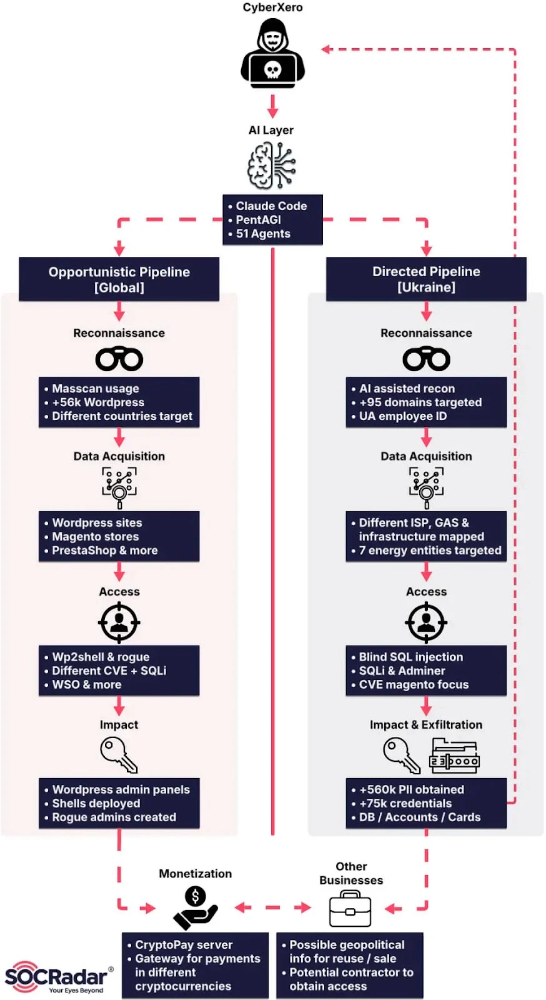

# CyberXero AI-Assisted Intrusions and Ukrainian Data Theft

**CyberXero**{.cve-chip} **AI-Assisted Intrusions**{.cve-chip} **Initial Access Broker**{.cve-chip} **WordPress Targeting**{.cve-chip} **Data Exfiltration**{.cve-chip}

## Overview

SOCRadar reported an ongoing AI-assisted intrusion campaign attributed to CyberXero, described as a Russian-speaking operator assessed to be a financially motivated initial access broker.

Active since at least July 2026, the campaign combines automated attacks against WordPress and e-commerce environments with selective reconnaissance and manual exploitation against Ukrainian energy and critical-infrastructure organizations.

Researchers reported confirmed exfiltration from four Ukrainian organizations involving more than 628,000 records associated with Ukrainian individuals. Additional confirmed compromises were reported in Poland, China, and the Netherlands.

The report’s evidence is based on an exposed attacker working directory containing tooling, AI-session logs, credentials, reconnaissance output, and stolen data.

This incident page focuses only on CyberXero. The same source article also discusses Operation Master, which is a separate operation and should not be conflated with CyberXero attribution or victimology.

## Technical Details

### Discovery and Campaign Infrastructure

SOCRadar identified an exposed directory at `46.21.250[.]135` linked to the operator’s Linux workstation. Reported contents included:

- AI-session logs
- Scripts with plaintext tokens
- Exploitation toolkits
- AI-agent configurations
- Reconnaissance results
- Exfiltrated victim data

Researchers described an infrastructure of eight nodes, including an operator workstation, provisioning server, monetization infrastructure, payload-staging servers, and a target-scanning system.

### Two Distinct Attack Pipelines

- Global opportunistic pipeline: broad targeting of WordPress and e-commerce systems for access and payment-data opportunities.
- Directed pipeline: selective focus on Ukrainian energy/utilities (including a heating provider in Kharkiv), emphasizing deeper reconnaissance and manual exploitation.

Reporting did not establish state sponsorship or confirmed disruption of industrial processes.

### Vulnerabilities and Exposed Services

Reported WordPress exploitation paths include:

- CVE-2026-63030
- CVE-2026-60137
- CVE-2026-4815 (Support Board WordPress plugin SQL injection)

The campaign also targeted internet-exposed Redis services, with two Chinese entities reportedly compromised through Redis exposure. The cited reporting does not provide a specific Redis CVE or full product-by-product software version matrix.

### Observed Automation and AI Use

In one documented automated run, the operator reportedly:

- Scanned 4,708 targets
- Confirmed access to 429 WordPress administration panels
- Deployed 32 web shells within 61 seconds

These values describe one observed run, not a campaign-wide victim total.

The operation used two AI-assisted arrangements:

- Claude Code environment with 51 specialized agents for scanning, chaining, reconnaissance, and post-exploitation support.
- PentAGI (self-hosted open-source pentesting agent) connected with Cobalt Strike through an AI-provider API for payload/testing workflows.

Recovered logs reportedly show both attempted policy-evasion prompts and blocked/refused requests. This supports operator misuse of AI tools but does not establish compromise of AI-provider infrastructure or that every malicious requested action succeeded.

### Attribution and Status Notes

CyberXero is a researcher-assigned cluster name. Language indicators and operational behavior support assessment context, but do not by themselves prove nationality or state affiliation.

Campaign activity was described as ongoing at publication time, with confirmed compromise/exfiltration evidence but incomplete public victim and timeline disclosure.

## Technical Specifications

| **Attribute** | **Details** |
|---|---|
| **Cluster Name** | CyberXero (researcher-assigned) |
| **Operational Characterization** | AI-assisted intrusion activity with IAB-like monetization patterns |
| **Primary Opportunistic Targets** | WordPress, e-commerce environments, exposed Redis services |
| **Directed Targeting Focus** | Ukrainian energy and utility-related organizations |
| **Confirmed Exfiltration Context** | Four Ukrainian organizations, 628,000+ associated records (reported) |
| **Automation Snapshot** | 4,708 scanned targets, 429 admin-panel accesses, 32 web shells in 61 seconds (single observed run) |

## Affected Products

- WordPress-based sites and plugins (including Support Board exposure in reported paths).
- E-commerce deployments (including Magento and PrestaShop in defensive guidance context).
- Internet-exposed Redis-backed systems.
- Public-facing IT systems in energy and utility sectors.

## Attack Scenario

1. Automated infrastructure scans WordPress and e-commerce targets while selective reconnaissance profiles Ukrainian energy/utility targets.
2. Initial exploitation uses reported WordPress vulnerability paths and exposed-service attacks (including Redis exposure abuse).
3. Compromise is established through admin-access takeover and/or web-shell deployment in observed automation runs.
4. AI-assisted workflows (Claude Code agents and PentAGI/Cobalt Strike integrations) support reconnaissance and post-exploitation tasks.
5. Stolen data is collected and staged within attacker infrastructure.
6. Data from confirmed victims is exfiltrated and retained in attacker-controlled environments.
7. Opportunistic compromises may be monetized through access sales or payment-data abuse; selective infrastructure targeting may continue for additional intelligence or access value.

## Impact Assessment

=== "Confirmed Findings"

    - Exfiltration from four Ukrainian organizations involving more than 628,000 associated records
    - Additional confirmed compromises in Poland, China, and the Netherlands
    - One observed automated run showing high-speed scan/access/shell deployment behavior

=== "Potential Business and Operational Impact"

    - Unauthorized admin access and web-shell persistence on internet-facing systems
    - Continued data collection, application tampering, and follow-on compromise opportunities
    - Elevated exposure for energy and utility organizations with publicly reachable IT assets

=== "Scope Boundaries"

    - Public reporting does not establish confirmed PLC/SCADA/safety-system compromise
    - No publicly confirmed essential-service interruption was disclosed in the cited report

## Mitigation Strategies

1. Patch web applications and plugins exposed to the cited WordPress vulnerabilities.
2. Review WordPress/e-commerce systems for rogue admin accounts, WSO shells, and unauthorized code changes.
3. Remove unnecessary internet exposure of Redis and enforce strict network segmentation/access controls.
4. Review `~/.ssh/authorized_keys` on potentially exposed Redis hosts for unauthorized key insertion.
5. Preserve web, application, authentication, database, and network logs before destructive cleanup.
6. Where compromise is confirmed, remove persistence, rebuild from trusted images as needed, and rotate credentials/tokens/secrets.
7. Separate public-facing IT systems from operational environments and validate segmentation boundaries.
8. Alert on suspicious admin creation, unusual file uploads, interpreter execution from web contexts, unexpected SSH keys, and abnormal bulk data access.
9. Add campaign IOCs and behavior analytics to SIEM/NDR/IDS detections.

## Resources and References

!!! info "Public Reporting"
    - [CyberXero Uses Claude Code in Campaign](https://thehackernews.com/2026/10/cyberxero-uses-claude-code-in-campaign.html)

---

*Last Updated: October 13, 2026*
