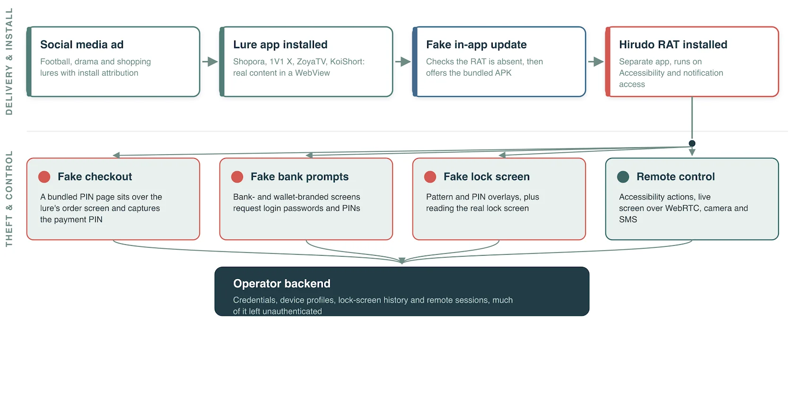
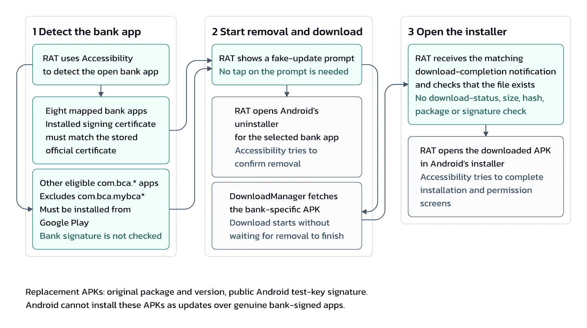

# Hirudo Android Banking Trojan

**Hirudo**{.cve-chip} **Android Banking Trojan**{.cve-chip} **App Replacement**{.cve-chip} **Credential Theft**{.cve-chip} **Accessibility Abuse**{.cve-chip}

## Overview

Hirudo is an Android banking Trojan that replaces legitimate banking applications with modified versions to steal credentials and bypass application security checks.

Reporting indicates it is distributed through malicious apps themed as shopping, entertainment, and adult-content services that masquerade as legitimate software.

## Technical Details

- Abuses Android Accessibility and notification permissions.
- Uses YAHFA and Dobby hooking frameworks to manipulate runtime behavior.
- Tampers with app-signature checks, Accessibility checks, screenshot protection, and Play Integrity verification.
- Collects banking credentials, payment PINs, SMS content, and device-unlock information.
- Supports remote screen viewing, camera access, and broader device control.
- Uses command infrastructure and backend management panels to operate compromised devices and handle stolen data.

## Technical Specifications

| **Attribute** | **Details** |
|---|---|
| **Malware Type** | Android banking Trojan |
| **Core Technique** | Replacement of legitimate banking apps with trojanized versions |
| **Privilege/Abuse Path** | Accessibility and notification-permission abuse |
| **Manipulation Frameworks** | YAHFA and Dobby hooking |
| **Primary Data Targets** | Banking credentials, PINs, SMS, unlock information |
| **Remote Capabilities** | Screen monitoring, camera access, and device-control functions |

## Affected Products

- Android devices that install malicious third-party applications.
- Mobile users relying on sideloaded or untrusted application sources.
- Banking applications targeted for replacement with modified malicious builds.

## Attack Scenario

1. Victim installs a malicious app disguised as a legitimate service.
2. App prompts installation of a second application via a fake update flow.
3. Trojan acquires required permissions and identifies targeted banking apps.
4. Victim is prompted to uninstall genuine banking app and install modified replacement.
5. Modified app conceals tampering, captures sensitive data, and supports fraudulent activity.

## Impact Assessment

=== "Primary Impact"

    - Theft of banking credentials and payment PINs
    - Potential unauthorized transactions and direct financial losses
    - Banking-account takeover and related identity-theft exposure

=== "Device Privacy Impact"

    - Exposure of private messages, screen contents, and camera feeds
    - Remote control risk on infected Android endpoints

=== "Trust and Ecosystem Impact"

    - Reduced confidence in mobile banking app integrity and update flows

## Mitigation Strategies

1. Install apps only from trusted sources and validate publisher/developer authenticity.
2. Reject unexpected banking-app replacement or unsolicited update prompts.
3. Review and revoke unnecessary Accessibility and notification permissions.
4. Keep Android OS and banking apps fully updated and ensure Google Play Protect is active.
5. For banking providers, enforce server-side app-integrity and attestation validation.
6. Implement behavioral fraud detection and transaction-risk analytics.
7. If infection is suspected, use a trusted device to contact the bank, secure accounts, and investigate unauthorized transactions.

## Resources and References

!!! info "Public Reporting"
    - [Hirudo Android Trojan Uses Patched Banking Apps to Bypass Their Built-In Security Checks](https://thehackernews.com/2026/10/hirudo-android-trojan-uses-patched.html)
    - [Hirudo Android Trojan Replaces Banking Apps to Steal Credentials](https://securityaffairs.com/200970/malware/hirudo-android-trojan-replaces-banking-apps-to-steal-credentials.html)
    - [Hirudo Android malware replaces banking apps to evade security checks](https://www.bleepingcomputer.com/news/security/hirudo-android-malware-replaces-banking-apps-to-evade-security-checks/)
    - [Hirudo Android trojan swaps real banking apps for patched copies | Hacker Posts](https://www.hackerposts.org/en/blog/hirudo-android-banking-trojan-app-replacement)
    - [Hirudo: From Fake Updates to Patched Banking Apps](https://www.threatfabric.com/blogs/hirudo-from-fake-updates-to-patched-banking-apps)

---

*Last Updated: October 15, 2026*
