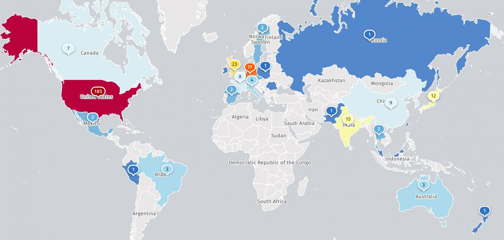

# Exploitation Attempts Against SonicWall SMA 1000 SSRF Vulnerability

**SonicWall SMA 1000**{.cve-chip} **CVE-2026-102255**{.cve-chip} **Pre-Auth SSRF**{.cve-chip} **CVSS 10.0**{.cve-chip} **Exploitation Attempts**{.cve-chip}

## Overview

Threat-intelligence researchers reported exploitation attempts targeting CVE-2026-102255, a pre-authentication server-side request forgery (SSRF) vulnerability in SonicWall Secure Mobile Access (SMA) 1000 appliances.

The issue is rated CVSS 10.0 and can allow an unauthenticated remote attacker to make an affected appliance issue requests on the attacker’s behalf, potentially reaching internal functionality and enabling unauthorized operations.

SonicWall released patches on October 6, 2026, and researcher reporting indicated observed exploitation attempts beginning on October 8. Public reporting confirms attack attempts against monitoring infrastructure and decoys; it does not publicly verify successful compromise of production customer deployments.

## Technical Details

### Vulnerability and Affected Products

CVE-2026-102255 is a pre-authentication SSRF vulnerability in the SMA 1000 Appliance WorkPlace interface. Reporting describes an unintended alternate access path allowing remote attackers to direct request flow without prior authentication.

Affected models include:

- SonicWall SMA 6210
- SonicWall SMA 7210
- SonicWall SMA 8200v

Not affected (per reporting context):

- SonicWall SMA 100 Series appliances
- SonicWall firewall SSL-VPN functionality

Reported affected firmware builds:

- 12.4.3-03526 platform-hotfix and earlier
- 12.5.0-02952 platform-hotfix and earlier

Reported fixed firmware builds:

- 12.4.3-03670 platform-hotfix
- 12.5.0-03082 platform-hotfix

### Observed Exploitation Attempt Activity

- Previdian reported 135 exploitation attempts from two U.S.-located IP addresses.
- Defused Cyber reported attempts against SMA decoys beginning October 8.
- The reported numbers reflect observed attempts on monitoring systems, not confirmed counts of compromised organizations/appliances.
- No named threat actor was publicly confirmed in the cited reporting.

### Timeline Context

- SonicWall’s disclosure-time statement indicated no evidence of in-the-wild exploitation at that time.
- Subsequent researcher reporting described later-detected exploitation attempts.
- Available public reporting does not independently confirm successful exploitation against production customer environments.

## Technical Specifications

| **Attribute** | **Details** |
|---|---|
| **CVE** | CVE-2026-102255 |
| **Vulnerability Type** | Pre-authentication SSRF |
| **Exposure Surface** | SonicWall SMA 1000 WorkPlace interface |
| **Severity** | CVSS 10.0 (critical) |
| **Observed Threat Activity** | Attempted exploitation detected by external monitoring and decoys |
| **Confirmed Outcome in Public Reporting** | Attempt activity confirmed; production compromise not publicly verified |

## Affected Products

- SonicWall SMA 6210, SMA 7210, SMA 8200v running affected builds.
- Organizations using SMA 1000 WorkPlace for secure remote access.

## Attack Scenario

1. Attacker identifies an internet-reachable SMA 1000 WorkPlace interface on vulnerable firmware.
2. Attacker sends crafted requests through an unintended alternate access path.
3. SSRF condition causes the appliance to issue requests on behalf of the attacker without authentication.
4. Attacker attempts to reach internal appliance functionality and perform unauthorized operations.
5. Follow-on impact depends on reachable internal services and enforcement controls.
6. Research monitoring systems and decoys observe attempt traffic.
7. Public reporting does not confirm a verified compromise chain to root execution, credential theft, or ransomware deployment for this specific vulnerability.

## Impact Assessment

=== "Confirmed Findings"

    - Critical unauthenticated SSRF vulnerability affects specified SMA 1000 models/firmware branches
    - Exploitation attempts were observed shortly after disclosure and patch release
    - Public reports did not disclose verified customer victim counts or named compromised organizations

=== "Potential Impact"

    - Unauthorized interaction with internal appliance functionality
    - Security weakening of remote-access gateways
    - Possible downstream compromise depending on accessible services and privilege boundaries

=== "Evidence Boundaries"

    - SSRF should not be assumed equivalent to full appliance takeover or RCE without demonstrated follow-on exploitation stages

## Mitigation Strategies

1. Apply security updates immediately:

    - 12.4.3 branch: update to 12.4.3-03670 platform-hotfix
    - 12.5.0 branch: update to 12.5.0-03082 platform-hotfix

2. Verify the running build after patch installation.
3. Do not rely solely on workaround-style exposure reduction when a fix is available.
4. Restrict administrative access paths and remove unnecessary public exposure where operationally possible.
5. Review appliance access logs, admin activity, and unusual outbound/internal request behavior.
6. Preserve appliance and network telemetry before disruptive remediation.
7. If unauthorized activity is confirmed, engage incident response and SonicWall support, then rotate potentially exposed credentials/secrets.

## Resources and References

!!! info "Public Reporting"
    - [Max-Severity SSRF Flaw in SonicWall SMA Devices Under Attack](https://www.darkreading.com/vulnerabilities-threats/max-severity-ssrf-flaw-sonicwall-sma-devices-under-attack)
    - [SonicWall warns of max severity SSRF flaw in SMA1000 gateways](https://www.bleepingcomputer.com/news/security/sonicwall-warns-of-max-severity-ssrf-flaw-in-sma1000-gateways/)
    - [Critical SonicWall SMA 1000 flaw](https://thehackernews.com/2026/10/critical-sonicwall-sma-1000-flaw.html)
    - [SonicWall fixes pre-auth SSRF flaw in SMA 1000 appliances (CVE-2026-102255)](https://www.helpnetsecurity.com/2026/10/07/sonicwall-fixes-pre-auth-ssrf-flaw-in-sma-1000-appliances-cve-2026-102255/)

---

*Last Updated: October 13, 2026*
