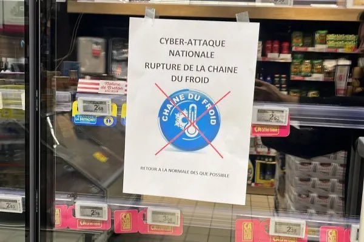
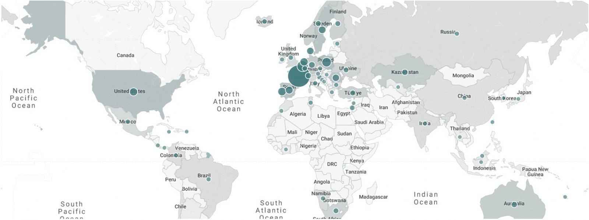

# Cyberattack Disrupts Refrigeration at French Supermarkets

**French Supermarkets**{.cve-chip} **Refrigeration Disruption**{.cve-chip} **Danfoss Controllers**{.cve-chip} **Cold-Chain Risk**{.cve-chip} **OT/IT Incident**{.cve-chip}

## Overview

Attackers reportedly manipulated refrigeration systems overnight on October 11-12, 2026 across multiple French supermarket chains, using compromised Danfoss refrigeration controllers to trigger automatic defrosting.

The temperature increase disrupted preservation of fresh and frozen products. French media reports cited approximately 250-350 affected stores, with resulting food waste and financial losses.

Intermarche and Cooperative U publicly confirmed refrigeration-related disruption, and the Paris prosecutor's office opened an investigation. The initial access path and responsible actor remain publicly unconfirmed.

## Technical Details

### Affected Systems and Organizations

The reported activity targeted refrigeration controllers running older Danfoss control software and abused built-in automatic defrost functionality.

Public reporting names Intermarche, Cooperative U, Carrefour Market, Monoprix, Leclerc, and Super U among affected chains. Intermarche statements also referenced precautionary actions involving Intermarche and Netto.

Intermarche additionally indicated the incident reportedly affected a service provider involved in in-store refrigeration management. This is investigative context and does not by itself confirm a supplier-compromise mechanism.

### Initial Access and Vulnerability Status

The specific intrusion method has not been publicly confirmed. Reporting does not establish a definitive entry point such as:

- Confirmed exploited vulnerability
- Confirmed compromised account
- Confirmed remote-access service abuse
- Confirmed malware family

The article references prior Danfoss AK-SM 8xxA vulnerabilities:

- CVE-2025-41450 (authentication bypass; CISA warning in May 2025)
- CVE-2025-41451 (command injection; CISA warning in August 2025)

Prior research demonstrated remote code execution potential on publicly exposed Danfoss AK-SM 800A management interfaces, but those CVEs have not been confirmed as the mechanism in this incident.

Exact affected controller models, firmware versions, and incident-specific fixed versions were not disclosed in the cited report.

### Internet Exposure Context

Reported exposure counts included:

- 2,752 internet-exposed Danfoss systems identified by one researcher source (1,590 in France)
- More than 4,500 internet-reachable Danfoss devices reported by Shodan tracking

These are exposure metrics from different sources and should not be interpreted as compromise counts.

### Attribution and Investigation Status

No public attribution to a named threat actor or state has been confirmed in the reporting.

The Paris prosecutor's office is investigating victim scope and links to reported losses and fires; the existence of investigation activity does not establish causality for all reported downstream effects.

A separate Ahold Delhaize cybersecurity disclosure occurred the same day, but cited reporting explicitly states no evidence linking that event to this refrigeration incident.

## Technical Specifications

| **Attribute** | **Details** |
|---|---|
| **Incident Type** | Remote manipulation of refrigeration-control functionality |
| **Primary Technology Context** | Danfoss refrigeration-controller environment (older software in reporting) |
| **Observed Abuse Pattern** | Unauthorized triggering of automatic defrost functions |
| **Confirmed Public Victim Statements** | Intermarche and Cooperative U confirmed refrigeration disruption |
| **Attribution Status** | No publicly confirmed actor attribution |
| **Investigation Status** | Paris prosecutor investigation reported as active |

## Affected Products

- Refrigeration-control environments using relevant Danfoss management/controller systems.
- Retail food cold-chain operations dependent on centrally managed refrigeration/HVAC controls.

## Attack Scenario

1. Attacker gains access to refrigeration-control systems through a method not yet publicly disclosed.
2. Unauthorized control actions trigger automatic defrosting.
3. Refrigeration temperatures rise beyond expected preservation thresholds.
4. Fresh/frozen displays are taken out of service and products are removed as precaution.
5. Store operations and refrigeration specialists work to restore control and temperatures.
6. Authorities investigate incident scope, victim impact, and possible links to related reports.

## Impact Assessment

=== "Confirmed and Reported Impact"

    - Intermarche and Cooperative U confirmed refrigeration-system disruption
    - Product-removal precautions were reported at affected locations
    - French outlets reported an estimated 250-350 affected stores with food loss and financial impact

=== "Potential Operational Impact"

    - Cold-chain integrity and product availability disruption
    - Inventory loss and business interruption in food-retail operations
    - Safety and compliance risk requiring product-quality validation before resumption

=== "Evidence Boundaries"

    - Public reporting does not confirm consumer illness linked to this event
    - No confirmed ransomware deployment was reported in this incident
    - Fire-related investigative leads do not independently prove cyber-causation

## Mitigation Strategies

1. Identify refrigeration controllers and remote-management interfaces, then remove unnecessary direct internet exposure.
2. Restrict required management access through approved, hardened access paths.
3. Verify controller models/firmware against official Danfoss advisories, including CVE-2025-41450 and CVE-2025-41451 guidance.
4. Compare live defrost schedules, setpoints, alarms, accounts, and remote-access settings against approved baselines.
5. Preserve logs before resetting or reimaging equipment.
6. Audit service-provider and maintenance access with named accounts, least privilege, and time-bound permissions.
7. Maintain independent temperature monitoring and escalation paths outside controller-only visibility.
8. Coordinate recovery with refrigeration engineers, food-safety teams, operations, and incident responders.
9. Segment refrigeration controls from general business and guest networks.
10. Maintain known-good configuration backups and rehearse manual response and product-relocation playbooks.

## Resources and References

!!! info "Public Reporting"
    - [Cyberattack shuts down refrigerators at French supermarkets](https://www.bleepingcomputer.com/news/security/cyberattack-shuts-down-refrigerators-at-french-supermarkets/)

---

*Last Updated: October 13, 2026*
