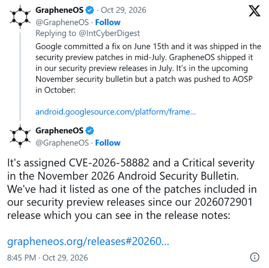

# Android SMS of Death - CVE-2026-58882

**Android**{.cve-chip} **SMS of Death**{.cve-chip} **CVE-2026-58882**{.cve-chip} **WAP Push**{.cve-chip} **Zero-Click DoS**{.cve-chip}

## Overview

A vulnerability in Android known as SMS of Death allows remote attackers to disrupt cellular communication by sending a specially crafted invisible WAP Push SMS.

The attack is zero-click because Android processes the message automatically before it appears in the normal SMS inbox. Successful exploitation can crash telephony services, interrupt active calls, and temporarily prevent users from making or receiving calls, including emergency calls.

A public proof of concept (PoC) was released by security researcher Mark Blaszczyk.

## Technical Details

- The issue affects Android's `WapPushOverSms` component in the telephony framework.
- The flaw exists in `decodeWapPdu()` due to improper validation of WAP Push header length.
- A 64-bit integer is converted into a 32-bit signed integer without sufficient range checks, leading to integer overflow.
- The resulting negative value is used for array allocation, triggering an unhandled `NegativeArraySizeException`.
- This can crash the `com.android.phone` process and disrupt cellular services.
- Delivery path is a data SMS over WAP Push port `2948`.

## Technical Specifications

| **Attribute** | **Details** |
|---|---|
| **Vulnerability** | CVE-2026-58882 |
| **Nickname** | SMS of Death |
| **Component** | Android `WapPushOverSms` (`decodeWapPdu()`) |
| **Weakness Type** | Integer overflow leading to negative array allocation |
| **Exception Trigger** | `NegativeArraySizeException` |
| **Affected Service** | `com.android.phone` / telephony subsystem |
| **Attack Interaction** | None (zero-click) |
| **Delivery Method** | Crafted WAP Push data SMS on port `2948` |
| **Observed Outcome** | Call disruption and temporary cellular denial of service |

## Affected Products

- Android devices running vulnerable telephony framework builds without the fix for CVE-2026-58882.
- Especially at-risk fleets include older Android versions (including Android 12 and 13) where patch availability may be limited.

## Attack Scenario

1. Attacker obtains the victim phone number.
2. Attacker sends a crafted WAP Push SMS to the target device.
3. Android automatically processes the message with no user interaction.
4. Malformed header processing triggers integer overflow in `decodeWapPdu()`.
5. The resulting exception crashes `com.android.phone`.
6. Victim experiences dropped calls and disrupted cellular availability.
7. Repeated messages may cause recurring crashes and prolonged service denial.

## Impact Assessment

=== "Availability Impact"

    - Temporary or prolonged loss of cellular connectivity
    - Interruption of incoming and outgoing phone calls
    - Repeated telephony crashes with possible boot-loop-like service instability

=== "Safety and Operational Impact"

    - Potential inability to contact emergency services during disruption windows
    - Increased risk for users and organizations dependent on mobile voice availability

=== "Exploitation Scope"

    - No demonstrated arbitrary code execution or personal-data theft in current reporting
    - ThaiCERT reporting (as of November 2, 2026) noted no confirmed real-world exploitation

## Mitigation Strategies

1. Install the latest Android security updates from Google and device vendors.
2. Ensure devices receive the fix for CVE-2026-58882 (Google November 2026 bulletin, patch level `2026-11-01`).
3. Prioritize remediation for older Android fleets, especially Android 12 and 13.
4. Replace unsupported devices that can no longer receive security updates.
5. Monitor patch compliance through MDM or endpoint-management tooling.
6. Investigate repeated `com.android.phone` crashes and abnormal cellular interruptions.
7. Maintain alternate emergency communication methods for critical personnel.

## Resources and References

!!! info "Public Reporting"
    1. [SMS of Death: Android under attack, an invisible SMS can block calls and emergency services](https://securityaffairs.com/202184/security/sms-of-death-android-under-attack-an-invisible-sms-can-block-calls-and-emergency-services.html)
    2. [Android 'SMS of Death' - CyberStack](https://cyberstack.org/n/android-sms-of-death-wap-push-dos-cve-2026-58882-poc-20261029)
    3. [New Android SMS of Death exploit can remotely crash unpatched phones](https://www.bleepingcomputer.com/news/security/new-android-sms-of-death-exploit-can-remotely-crash-unpatched-phones/)
    4. [Android SMS of Death can brick phones and drop emergency calls](https://cybernews.com/security/android-sms-of-death-critical-vulnerability/)

---

*Last Updated: November 3, 2026*
