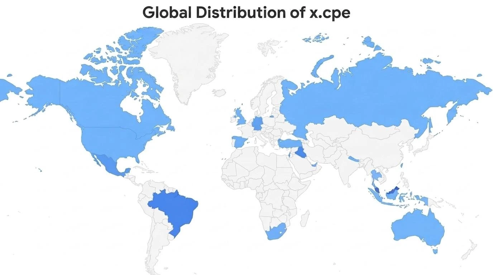
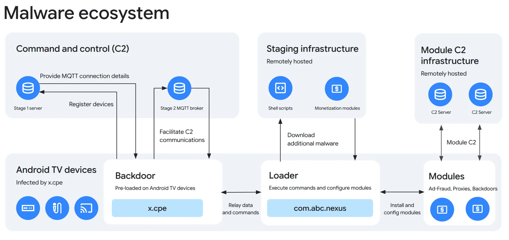

# Google Disrupts a Botnet Affecting More Than 1.3 Million Android TV Devices

**Google Threat Intelligence**{.cve-chip} **XCPE Botnet**{.cve-chip} **Android TV**{.cve-chip} **Firmware Backdoor**{.cve-chip} **Supply-Chain Risk**{.cve-chip}

## Overview

Google and cybersecurity partners reported disruption of the XCPE botnet, described as affecting more than 1.3 million Android TV streaming devices.

Google attributed the operation with high confidence to Chinese manufacturer Videostrong Technology Co., alleging the company embedded a persistent backdoor into device firmware before distribution. Reported follow-on abuse by criminal affiliates included advertising fraud, residential proxy services, and additional malware distribution.

Google also announced enforcement actions, including termination of relationship with Videostrong, revocation of authorization to manufacture certified Android devices with Google services, and a ban on the company and future affiliates from supplying certified Android manufacturers.

## Technical Details

The primary backdoor components were identified as `x.cpe` and `com.oemservice`, reportedly operating with Android system-level privileges.

Command-and-control communication used HTTP and MQTT channels. Reported infrastructure included:

- `anyevonline[.]com` for C2 configuration and connection metadata.
- `mqtt.szbboys[.]com` as MQTT broker for remote command delivery.

Reported capabilities included:

- Executing shell commands and scripts with system privileges.
- Silent download and installation of additional applications.
- Disabling Google Play Protect.
- Capturing screenshots and injecting keystrokes.
- Collecting account data, device details, installed app lists, and system logs.
- Network reconnaissance and reverse-shell establishment.

The malware reportedly used a modular architecture for extensible malicious plugins and maintained persistence through the `/oem/` partition, enabling reinfection after attempted removal and reboot.

## Technical Specifications

| **Attribute** | **Details** |
|---|---|
| **Botnet Name** | XCPE |
| **Affected Device Class** | Android TV/set-top streaming devices |
| **Scale Reported** | More than 1.3 million devices in over 200 countries |
| **Primary Malware Components** | `x.cpe`, `com.oemservice` |
| **Privilege Level** | System-level Android privileges |
| **C2 Protocols** | HTTP and MQTT |
| **Noted Infrastructure** | `anyevonline[.]com`, `mqtt.szbboys[.]com` |
| **Persistence Method** | `/oem/` partition persistence |
| **Abuse Use Cases** | Residential proxying, ad fraud, malware distribution |

## Affected Products

- Android TV boxes and related streaming devices in affected supply chains.
- Devices with firmware images containing preinstalled XCPE-related components.
- Environments relying on unverified or unauthorized device vendors.

## Attack Scenario

1. A firmware backdoor is allegedly embedded into devices during manufacturing.
2. Affected devices are distributed under various brands/models.
3. Once online, devices initiate contact with attacker-controlled C2 infrastructure.
4. MQTT channels are used to receive remote tasking and module updates.
5. Threat operators or affiliates install additional payloads and use compromised devices for proxy and fraud operations.
6. Persistence in firmware-backed partitions supports continued compromise across reboots.

## Impact Assessment

=== "Scale and Exposure Impact"

    - Reported compromise of more than 1.3 million Android TV devices across 200+ countries
    - Residential IP addresses may be abused for third-party traffic relays without owner awareness

=== "Security and Control Impact"

    - Extensive remote command capability on compromised devices
    - Potential installation of additional malware and expanded attack surface

=== "Supply-Chain and Trust Impact"

    - Serious concerns over firmware integrity and manufacturer accountability
    - Elevated risk to organizations integrating unvetted IoT/media devices into broader networks

## Mitigation Strategies

1. Disconnect suspected infected devices from the internet to cut active C2 communication.
2. Identify affected models and validate firmware integrity.
3. Reflash with clean, trusted firmware where available.
4. Replace devices when trustworthy firmware is unavailable.
5. Avoid procurement from unverified manufacturers or unauthorized distributors.
6. Monitor suspicious outbound traffic and unusual MQTT communication patterns.
7. Segment IoT/media devices away from sensitive enterprise and operational networks.
8. Require stronger manufacturer firmware-integrity controls and pre-distribution security testing.
9. Maintain recurring firmware updates and periodic security assessments for connected devices.

## Resources and References

!!! info "Public Reporting"
    1. [Google disrupts million-device XCPE Android malware botnet, bans TV box maker](https://www.bleepingcomputer.com/news/security/google-disrupts-million-device-xcpe-android-malware-botnet-bans-tv-box-maker/)
    2. [Google Disrupts 1.3 Million-Device Android Botnet, Says TV Box Maker Sold Criminal Access](https://thehackernews.com/2026/11/google-disrupts-13-million-device.html)
    3. [Shutting the Door on the XCPE Botnet | Google Cloud Blog](https://cloud.google.com/blog/topics/threat-intelligence/shutting-the-door-on-the-xcpe-botnet/)
    4. [Industry Takedown of Botnet Hidden in More Than 1.3 Million TV Set-Top Boxes across 200 Countries](https://newsroom.trendmicro.com/2026-11-02-Industry-Takedown-of-Botnet-Hidden-in-More-Than-1-3-Million-TV-Set-Top-Boxes-across-200-Countries)

---

*Last Updated: November 3, 2026*
