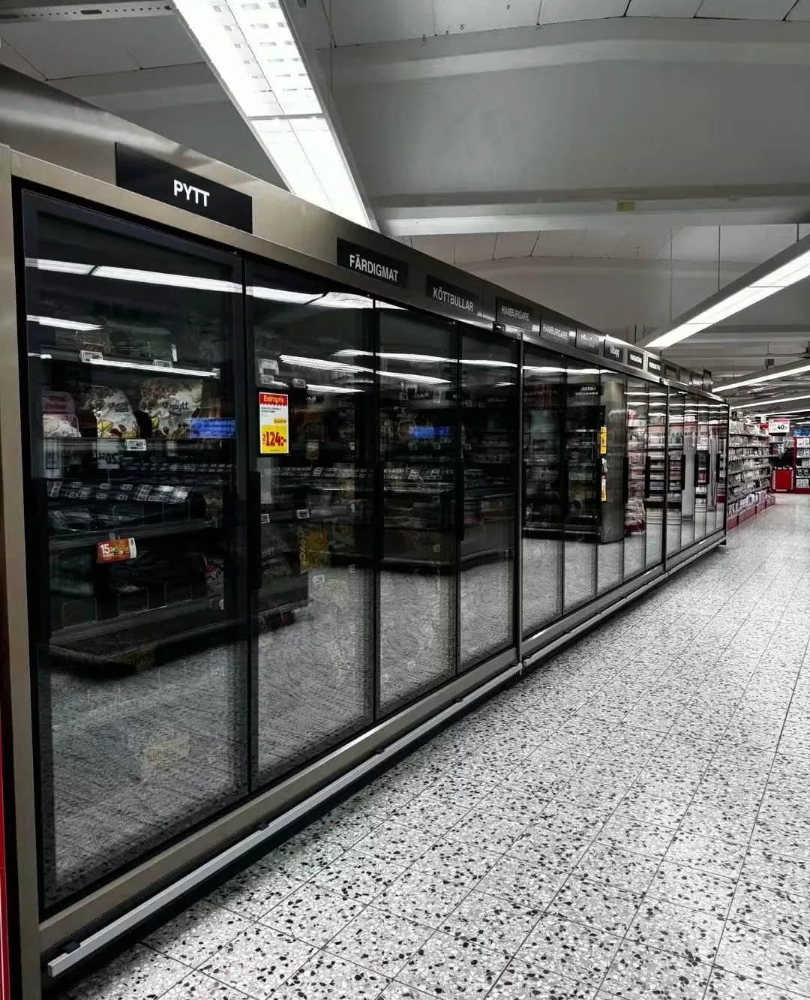
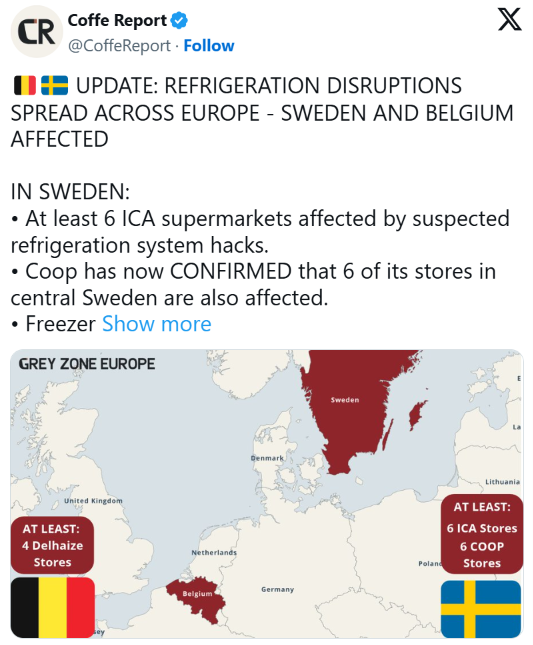

# European Supermarket Refrigeration System Cyberattacks

**OT Security**{.cve-chip} **Refrigeration Systems**{.cve-chip} **Forced Defrost Abuse**{.cve-chip} **Credential Compromise**{.cve-chip} **Retail Disruption**{.cve-chip}

## Overview

A wave of cyberattacks targeted supermarket refrigeration and freezer systems across Europe on November 2, 2026. Reported affected chains included Ahold Delhaize, Colruyt, ICA, and Coop.

Attackers reportedly manipulated refrigeration controls so units heated instead of maintaining required cooling temperatures. In some stores, temperatures were reported near 50C, causing food losses and operational disruption.

The incidents followed similar attacks reported against hundreds of French supermarkets in October 2026.

## Technical Details

- Attackers reportedly abused forced-defrost functionality in refrigeration control systems.
- Evaporators were remotely switched into defrost mode, reportedly on a continuous basis.
- Temperature setpoints were reportedly changed to approximately 50C.
- Affected environments included remotely managed refrigeration equipment associated with Danfoss.
- Prior French investigations indicated attacker access via credentials for internet-exposed control systems.
- Exact initial-access technique for all November incidents remains unconfirmed.

## Technical Specifications

| **Attribute** | **Details** |
|---|---|
| **Incident Type** | Operational-technology manipulation impacting refrigeration availability and safety |
| **Primary Target** | Supermarket refrigeration/freezer control systems |
| **Observed Abuse Function** | Forced defrost and unauthorized temperature-setpoint changes |
| **Reported Peak Temperature** | Around 50C in affected cases |
| **Likely Access Paths** | Compromised credentials and exposed remote management interfaces |
| **Vendor Context in Reporting** | Danfoss-associated remotely managed refrigeration environments |
| **Status of Root Cause** | Complete initial-access method not fully confirmed across all incidents |

## Affected Products

- Supermarket refrigeration and freezer management systems with remote-control capability.
- OT interfaces exposed directly to the internet.
- Deployments with weak, reused, or compromised credentials.

## Attack Scenario

1. Attackers identify internet-exposed refrigeration management systems.
2. Attackers obtain unauthorized access, reportedly including credential abuse in some cases.
3. Attackers access refrigeration control interfaces.
4. Attackers change configuration and trigger forced-defrost operation remotely.
5. Systems heat rather than cool, driving unsafe storage temperatures.
6. Food spoilage, operational disruption, and potential safety hazards follow.

## Impact Assessment

=== "Operational Impact"

    - Significant food losses from elevated cooler/freezer temperatures
    - Broad retail disruption across multiple countries and store operations

=== "Financial and Safety Impact"

    - Direct financial losses from discarded goods and recovery work
    - Potential fire hazards and elevated food-safety risk from improper storage

=== "Response Burden"

    - Added costs for incident investigation, restoration, and hardening of OT remote-access controls

## Mitigation Strategies

1. Remove direct internet exposure of refrigeration and OT management interfaces.
2. Enforce MFA for all remote access paths.
3. Replace default credentials and enforce strong authentication policies.
4. Update and patch refrigeration-management software and firmware.
5. Segment IT and OT networks with tightly controlled interconnections.
6. Restrict remote access to authorized users through secure VPN workflows.
7. Monitor unauthorized configuration changes and unexpected defrost activation.
8. Deploy independent temperature monitoring with automated alerting.
9. Maintain secure backups of refrigeration system configurations.

## Resources and References

!!! info "Public Reporting"
    1. [Hackers disrupt refrigeration systems at European supermarkets](https://www.bleepingcomputer.com/news/security/hackers-disrupt-refrigeration-systems-at-european-supermarkets/)
    2. [Another fridge cyberattack hits European supermarkets, this time in Belgium, Luxembourg, Sweden and Estonia](https://securityaffairs.com/202260/security/another-fridge-cyberattack-hits-european-supermarkets-this-time-in-belgium-luxembourg-sweden-and-estonia.html)
    3. [Cyberattacks hit supermarket fridges and freezers in Europe, Belgium launches investigation](https://www.euronews.com/2026/11/02/cyberattack-hits-belgian-supermarket-fridges-and-freezers)
    4. [New cyberattack on supermarket fridges sweeps across Europe](https://www.reuters.com/business/retail-consumer/temperature-soars-swedish-grocery-store-freezers-one-store-blames-hackers-2026-11-02/)

---

*Last Updated: November 3, 2026*
