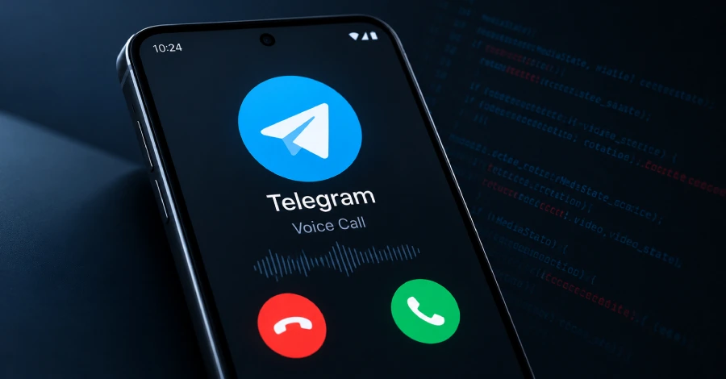
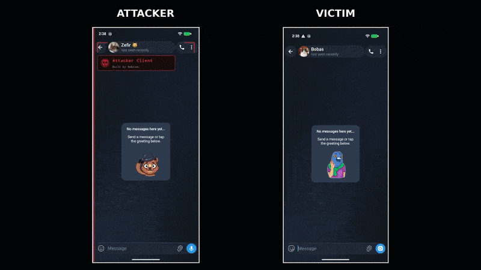

# Telegram Android Voice Call Vulnerability - Remote Code Execution (RCE)

**Telegram Android**{.cve-chip} **Voice Calls**{.cve-chip} **Potential RCE**{.cve-chip} **No CVE Assigned**{.cve-chip} **Patched in 12.10.4**{.cve-chip}

## Overview

A security vulnerability in Telegram for Android could allow attackers to execute code on a victim device through a Telegram voice call.

The attack requires the victim to answer the incoming call. The attacker only needs a regular Telegram account and does not require privileged account access.

According to reporting, affected versions are Telegram Android 8.6.2 through 12.10.3, and the issue was addressed in version 12.10.4. The flaw was discovered by NebuSec and publicly disclosed on October 29, 2026.

No confirmed real-world exploitation was reported by NebuSec at disclosure time.

## Technical Details

The reported vulnerability exists in Telegram's voice-call handling logic, specifically in processing of MediaState messages.

MediaState messages carry call-media status information such as microphone state, camera status, and video rotation. Improper handling of missing fields can cause access to an invalid memory location, creating a memory-handling condition that could potentially be leveraged for code execution.

NebuSec also reported that this issue may be chainable with two additional vulnerabilities:

- An information-disclosure weakness to escape the Telegram application environment.
- An Android root exploit to obtain elevated privileges.

In the reported chain, combined exploitation could potentially result in full device compromise.

No CVE identifier had been assigned as of disclosure.

## Technical Specifications

| **Attribute** | **Details** |
|---|---|
| **Issue Type** | Memory-handling flaw in call-message processing |
| **Affected Product** | Telegram for Android |
| **Affected Versions** | 8.6.2 through 12.10.3 |
| **Patched Version** | 12.10.4 |
| **Trigger Condition** | Victim answers attacker-initiated voice call |
| **Protocol Element** | Crafted MediaState call messages |
| **Privilege Requirement (Attacker)** | Standard Telegram account |
| **CVE Status at Disclosure** | No CVE assigned |
| **Exploit Context** | Potential RCE, with possible chaining to sandbox escape and root exploit |

## Affected Products

- Telegram for Android versions 8.6.2 through 12.10.3.
- Environments where users can receive voice calls from untrusted Telegram accounts.

## Attack Scenario

1. Attacker creates or uses a regular Telegram account.
2. Attacker initiates a private voice call to the target.
3. Victim answers the call.
4. Attacker sends specially crafted MediaState messages.
5. Vulnerable Telegram code processes malformed message state and may trigger memory corruption.
6. Attacker may achieve remote code execution in app context.
7. With additional vulnerabilities, attacker may attempt sandbox escape and Android root privilege escalation.

## Impact Assessment

=== "Primary Security Impact"

    - Potential unauthorized code execution on victim Android device
    - Possible access to private messages and sensitive information

=== "Surveillance and Privacy Impact"

    - Potential unauthorized microphone and camera access
    - Increased risk of covert monitoring if broader compromise is achieved

=== "Escalation and Enterprise Impact"

    - Potential bypass of app-level security boundaries through vulnerability chaining
    - Possible full-device compromise affecting personal and organizational data

Note: These are potential impacts described by researchers. No confirmed real-world exploitation or victim impact was reported in the cited coverage.

## Mitigation Strategies

1. Update Telegram for Android to version 12.10.4 or later.
2. Verify installed Telegram version in application settings.
3. Avoid answering unexpected voice calls from unknown Telegram accounts.
4. Set Telegram call privacy to Nobody where incoming calls are not required.
5. Keep Android OS and security patches current.
6. Install updates only from official, trusted distribution channels.
7. For organizations, enforce mobile app update compliance on managed Android fleets.

## Resources and References

!!! info "Public Reporting"
    1. [Telegram Android Flaw Lets Attackers Run Code When Users Answer Voice Calls](https://thehackernews.com/2026/10/telegram-android-flaw-lets-attackers.html)
    2. [GM driver data settlement: $220M over sales to insurers | Cybernews](https://cybernews.com/privacy/gm-settle-data-sharing/)

---

*Last Updated: November 3, 2026*
