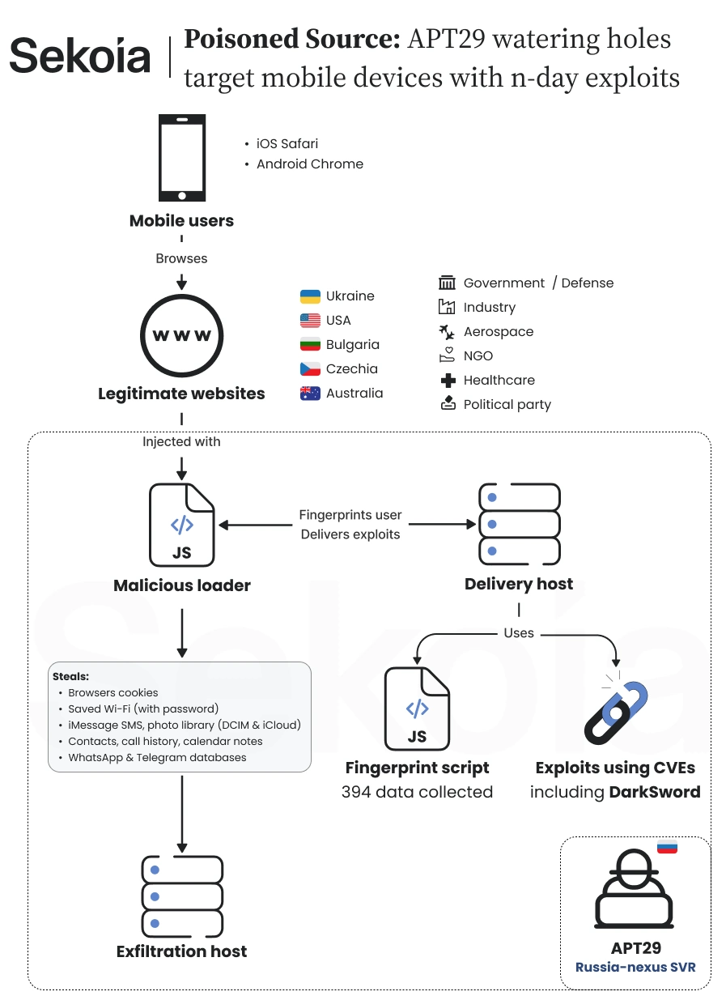

# APT29 Mobile Watering Hole Campaign

**APT29**{.cve-chip} **Mobile Exploitation**{.cve-chip} **Watering Hole**{.cve-chip} **Supply-Chain Compromise**{.cve-chip} **iOS/Android Targeting**{.cve-chip}

## Overview

A Russian-linked APT29 campaign targeted iOS and Android users through compromised legitimate websites, fake websites, and a supply-chain compromise affecting the Ukrainian web-analytics service Plerdy.

Sekoia discovered the operation in mid-October 2026. Attackers injected malicious JavaScript to fingerprint visiting devices and browser versions before delivering matching exploit chains.

The operation focused on theft of sensitive mobile data, including authentication cookies, credentials, messages, browsing history, Wi-Fi passwords, and other personal information. Reporting highlights continued expansion of state-sponsored mobile exploitation.

## Technical Details

Threat actor attribution in reporting: APT29 (Cozy Bear / Midnight Blizzard), linked to Russia's SVR with moderate-to-high confidence by Sekoia.

Initial access vectors:

- Compromised legitimate websites.
- Fake websites impersonating trusted entities.
- Supply-chain compromise of third-party analytics infrastructure.

Supply-chain compromise window reported for Plerdy SEO Tracker: August 27 to September 3, 2026.

Malicious JavaScript component: UltimateFingerprinter, used for browser/device profiling.

Exploit chains and payload naming in reporting:

- DarkSword for iOS targeting.
- AndroSnitch for Android targeting.

Reported targeted vulnerabilities:

- iOS: CVE-2025-43529, CVE-2024-27834, CVE-2026-20700, CVE-2025-14174, CVE-2025-43510, CVE-2025-43520.
- Android: CVE-2026-3910, CVE-2025-27038.

Targeted platforms included iOS 16.7, iOS 18.5, and Android devices running Chrome 139 to 145 (excluding 143).

Exfiltration was sent to attacker-controlled infrastructure. The campaign reportedly used known patched vulnerabilities rather than zero-days and did not establish persistence.

## Technical Specifications

| **Attribute** | **Details** |
|---|---|
| **Threat Actor** | APT29 (Cozy Bear / Midnight Blizzard), SVR-linked attribution in reporting |
| **Primary Technique** | Mobile watering-hole exploitation via web and analytics supply-chain compromise |
| **Supply-Chain Element** | Plerdy SEO Tracker compromise (reported Aug 27 - Sep 3, 2026) |
| **Fingerprinting Component** | UltimateFingerprinter JavaScript |
| **iOS Exploit Label** | DarkSword |
| **Android Exploit Label** | AndroSnitch |
| **Target Scope** | iOS and Android mobile users visiting affected sites |
| **Persistence Status** | No persistence reported in supplied sources |

## Affected Products

- iOS and Android mobile devices meeting vulnerable browser/OS conditions at time of exploit delivery.
- Websites integrating compromised third-party analytics scripts in affected period.
- Organizations and users relying on mobile browser sessions tied to sensitive accounts.

## Attack Scenario

1. Attackers compromise legitimate websites or deploy fake websites impersonating trusted entities.
2. Attackers compromise Plerdy tracker infrastructure and inject malicious JavaScript into dependent sites.
3. Victims browse affected pages on mobile devices.
4. JavaScript fingerprints device type, OS, and browser version.
5. Attackers deliver matching iOS or Android exploit chains.
6. Exploitation enables access to sensitive browser/device data.
7. Credentials, cookies, messages, and related data are collected.
8. Stolen data is exfiltrated to attacker-controlled infrastructure.

## Impact Assessment

=== "Credential and Session Impact"

    - Exposure of authentication cookies, credentials, and active sessions
    - Potential unauthorized access to email, cloud, and enterprise applications

=== "Privacy and Intelligence Impact"

    - Potential exposure of messages, contacts, location context, and personal data
    - Elevated intelligence-gathering risk for government, military, diplomatic, energy, and defense-linked targets

=== "Supply-Chain Impact"

    - Third-party analytics compromise expands risk to dependent websites
    - Increased operational burden for web integrity monitoring and response

## Mitigation Strategies

1. Update iOS, Android, and mobile browsers to latest supported security versions.
2. Apply patches for all identified CVEs referenced in reporting.
3. Retire outdated or unsupported mobile devices.
4. Enforce patch compliance with MDM policies.
5. Audit third-party JavaScript/analytics integrations across websites.
6. Monitor for unauthorized script modifications and suspicious external includes.
7. Implement CSP and SRI controls where feasible.
8. Monitor DNS/proxy/network telemetry for known malicious infrastructure.
9. Review active sessions and revoke suspicious cookies/tokens.
10. Enforce MFA, prioritizing phishing-resistant methods.
11. Conduct incident-response reviews for potentially exposed devices and rotate compromised credentials.

## Resources and References

!!! info "Public Reporting"
    1. [Russian APT29 Targets Mobile Users with Watering Hole Attacks](https://securityaffairs.com/202473/apt/russian-apt29-targets-mobile-users-with-watering-hole-attacks.html)
    2. [Russia-Linked Hackers Hit iOS, Android Devices With Exploit Chains via Watering Holes](https://www.securityweek.com/russia-linked-hackers-hit-ios-android-devices-with-exploit-chains-via-watering-holes/)

---

*Last Updated: November 9, 2026*
