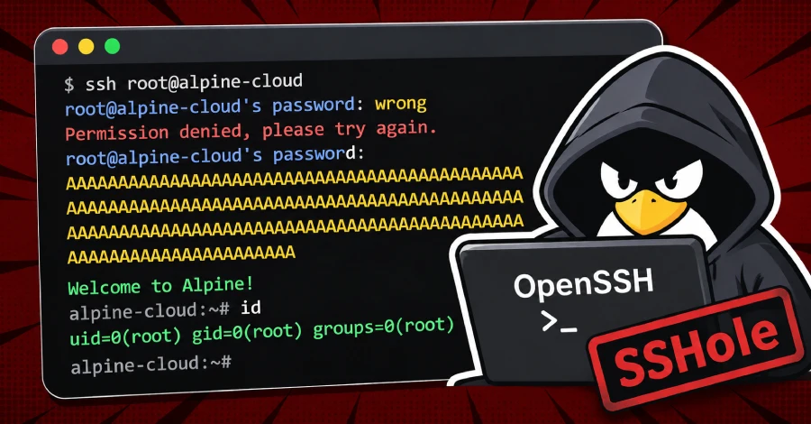
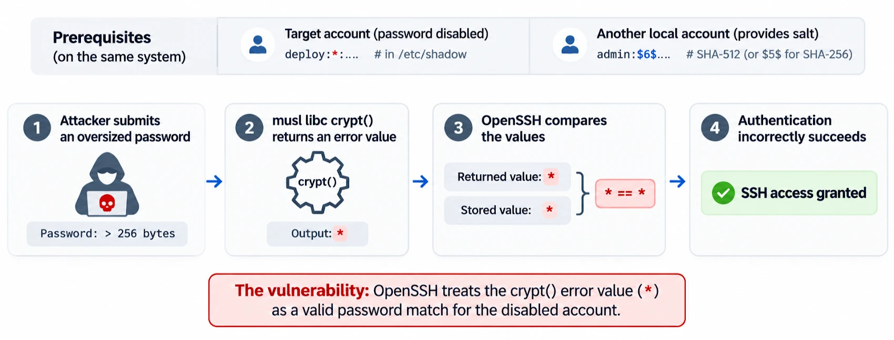

# OpenSSH SSHole Authentication Bypass

**OpenSSH**{.cve-chip} **SSHole**{.cve-chip} **CVE-2026-123158**{.cve-chip} **Auth Bypass**{.cve-chip} **musl/PAM Condition**{.cve-chip}

## Overview

Attackers have exploited CVE-2026-123158 (SSHole) to bypass SSH password authentication under specific configurations.

The issue affects Linux environments using musl libc with PAM authentication disabled. Attackers can submit specially sized passwords to access accounts configured without usable passwords.

Public reporting states exploitation attempts appeared within nine hours of disclosure, and researchers reported successful root-level exploitation on an Alpine Linux honeypot.

## Technical Details

The vulnerability is in OpenSSH password-authentication handling and relates to failed password-hashing behavior involving musl libc's `crypt()` implementation.

Under required conditions, an attacker submits an oversized password between 257 and 1024 bytes. The hashing operation may fail and return `*`, which can match stored password fields for certain accounts.

Authentication logic may then incorrectly treat the comparison as successful.

Required exploitation conditions include:

- Linux systems using musl libc.
- PAM authentication disabled.
- SSH password authentication enabled.
- Target account has `*` in password field.
- At least one other local account has a SHA-256 or SHA-512 crypt hash (`$5$` or `$6$`).

Affected versions: OpenSSH before 10.6p2, when these conditions are met.

## Technical Specifications

| **Attribute** | **Details** |
|---|---|
| **Vulnerability** | CVE-2026-123158 |
| **Nickname** | SSHole |
| **Vulnerable Component** | OpenSSH password authentication path |
| **Environment Constraint** | musl libc-based Linux with PAM disabled |
| **Trigger Input** | Oversized password (257-1024 bytes) |
| **Fault Condition** | Failed hash result `*` treated as matching disabled-password field |
| **Affected Versions** | OpenSSH versions prior to 10.6p2 (conditional) |
| **Observed Exploitation** | Honeypot root compromise reported; broad production compromise not established |

## Affected Products

- Linux systems running vulnerable OpenSSH builds under the required musl/PAM/password-auth conditions.
- Alpine Linux and other musl-based deployments with password auth enabled and risky account-password field states.

## Attack Scenario

1. Attacker discovers an internet-accessible SSH server with vulnerable OpenSSH conditions.
2. Attacker targets an account configured with disabled or unusable password state.
3. Attacker initiates SSH and sends an oversized password payload.
4. Hashing failure returns `*` under musl-related behavior.
5. OpenSSH incorrectly treats comparison as authenticated.
6. Attacker gains unauthorized account access.
7. Attacker runs reconnaissance commands such as `id`, `uname`, and `hostname`.
8. Depending on privileges, attacker may escalate impact through persistence, data access, or lateral movement.

## Impact Assessment

=== "Access and Credential Impact"

    - Unauthorized SSH access without valid credentials
    - Potential compromise of accounts expected to reject password logins

=== "Infrastructure Impact"

    - Exposure of sensitive files, secrets, deployment credentials, and SSH keys
    - Possible privilege abuse, lateral movement, and persistent-access changes

=== "Exploitation Status"

    - Root access on Alpine honeypot confirmed in reporting
    - Widespread production compromise not established in supplied sources

## Mitigation Strategies

1. Upgrade to OpenSSH 10.6p2 or apply distribution-provided security patches.
2. Disable SSH password authentication where feasible and enforce public-key authentication.
3. Review OpenSSH and musl libc configurations, especially on Alpine systems.
4. Audit SSH logs for unexpected successful password logins on accounts that should not allow them.
5. Review system logs for suspicious `Accepted password for` events.
6. Inspect recently created accounts, modified authorized_keys files, and anomalous processes/files.
7. Review doas and sudo activity for unexpected privilege escalation behavior.

## Resources and References

!!! info "Public Reporting"
    1. [Hackers Target OpenSSH SSHole Flaw Within Hours of Disclosure, Gain Root on Honeypot](https://thehackernews.com/2026/11/hackers-exploited-openssh-sshole-flaw.html)
    2. [GovCERT.HK - High Threat Security Alert (A26-11-09): Vulnerability in OpenSSH](https://www.govcert.gov.hk/en/alerts_detail.php?id=2164)
    3. [CVE-2026-123158 - Red Hat Customer Portal](https://access.redhat.com/security/cve/cve-2026-123158)

---

*Last Updated: November 9, 2026*
