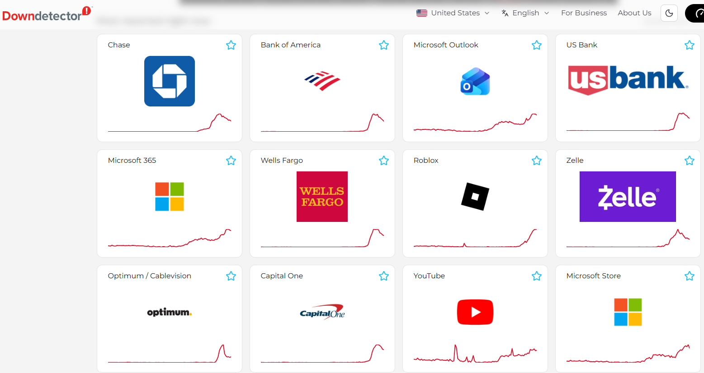
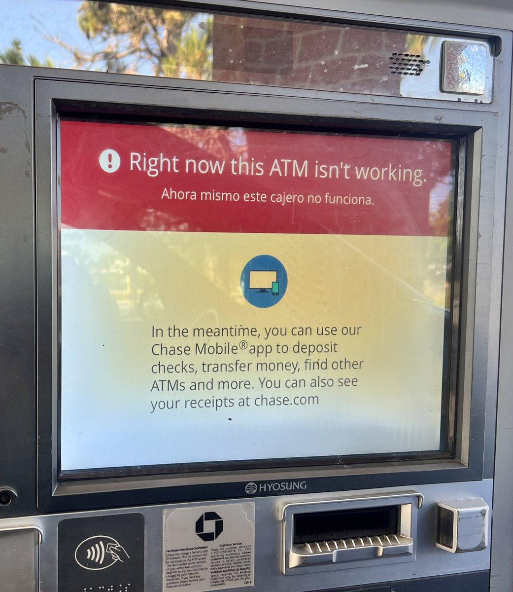

# U.S. Banks Struggle With Outages Amid Wider Technology Disruptions

**Infrastructure Outage**{.cve-chip}  
**Banking Systems**{.cve-chip}  
**Service Disruption**{.cve-chip}

## Overview

Several major U.S. banks experienced significant service disruptions affecting online banking, mobile applications, and financial transactions. Affected institutions included JPMorgan Chase, Bank of America, Wells Fargo, U.S. Bank, Capital One, and Truist. The disruptions resulted in customers being unable to access accounts, check balances, and complete transactions. Zelle users also reported payment delays. JPMorgan Chase attributed the disruption to a software bug in its on-premises hardware systems, with no evidence of a cyberattack. This incident highlighted the interconnected nature of financial infrastructure and how localized technical failures can cascade across multiple institutions.

## Technical Specifications

| **Attribute** | **Details** |
|---------------|-------------|
| **Incident Type** | Software Bug / Infrastructure Failure |
| **Root Cause** | Software bug in JPMorgan Chase on-premises hardware systems |
| **Affected Services** | Online banking, mobile applications, transaction processing, Zelle payments |
| **Severity** | High (widespread service disruption) |
| **Scope** | Multiple major U.S. financial institutions |
| **Attack Vector** | Not applicable (non-malicious internal technical failure) |
| **Cyberattack Involvement** | No confirmed evidence |
| **Impact Duration** | Temporary (service restored) |
| **Data Breach** | No confirmed customer data theft or unauthorized access |

## Affected Products

- JPMorgan Chase online banking and mobile applications
- Bank of America online banking and mobile applications
- Wells Fargo online banking and mobile applications
- U.S. Bank online banking and mobile applications
- Capital One online banking and mobile applications
- Truist online banking and mobile applications
- Zelle payment network (participating banks)

## Incident Description

### Technical Details

- A software bug affected JPMorgan Chase's on-premises hardware systems
- The issue caused certain transactions to take longer than expected to process
- Delays in Chase's transaction processing affected interactions with other financial institutions
- Zelle payment delays were associated with participating banks rather than a confirmed failure of the Zelle network itself
- The exact software component and root cause were not publicly disclosed

### Attack Scenario

- No confirmed attack scenario: The incident was attributed to an internal technical malfunction, not malicious activity
- A software bug affected critical banking infrastructure and slowed transaction processing
- Interdependencies between financial institutions contributed to wider payment delays
- The incident demonstrated how a localized infrastructure failure can lead to cascading service disruptions across interconnected financial services

## Impact Assessment

=== "Availability"
    * Temporary disruption of online and mobile banking services
    * Delays in processing financial transactions and bank transfers
    * Disruption to some Zelle payments
    * Service unavailability prevented customer access to critical financial services

=== "Confidentiality"
    * No confirmed customer data theft or unauthorized access was reported
    * Customer information was not compromised during the outage
    * Sensitive financial data remained protected despite service disruptions

=== "Integrity"
    * Transaction processing delays caused potential data inconsistencies
    * Account balances and transaction statuses were temporarily unreliable
    * Risk of transaction reconciliation issues following service restoration
    * Account information and transaction histories required verification post-incident

## Mitigation Strategies

### Immediate Actions
- Identify and isolate the faulty software component in JPMorgan Chase's on-premises hardware systems
- Implement emergency patches and hotfixes to restore service availability
- Coordinate with affected financial institutions to restore transaction processing
- Monitor transaction queues and implement manual processing procedures where necessary
- Provide real-time customer notifications regarding service restoration progress

### Short-term Measures
- Conduct comprehensive regression testing on all transaction-processing systems
- Implement transaction reconciliation procedures following service restoration
- Review and strengthen dependencies between banks and third-party payment providers
- Enhance communication protocols with partner financial institutions
- Establish alternative payment processing channels as backup systems

### Monitoring & Detection
- Continuously monitor transaction-processing systems and infrastructure performance
- Implement real-time alerting for transaction processing delays and anomalies
- Track interdependencies between financial institutions and monitor for cascading failures
- Monitor Zelle payment processing and participating bank transaction flows
- Establish performance baselines and alert thresholds for critical banking systems

### Long-term Solutions
- Implement redundant infrastructure and automatic failover mechanisms
- Establish comprehensive software testing and regression testing procedures
- Develop and test disaster recovery and business continuity plans
- Conduct regular simulations of service outage scenarios
- Improve incident response procedures and cross-institutional coordination
- Implement transaction reconciliation procedures as standard practice
- Maintain alternative payment channels during major service disruptions
- Improve customer notification and communication procedures

## Resources and References

!!! info "Official Sources"
    - [Technical issue at JPMorgan Chase triggers online banking delays | AP News](https://apnews.com/article/bank-outage-chase-wells-fargo-truist-50fee2693c22f597fa6ca51a97ef2cda)
    - [Widespread service outages at major U.S. banks appear to be over - CBS News](https://www.cbsnews.com/news/banks-online-service-outages-jpmorgan-chase-bank-of-america-wells-fargo/?shem=aimgspe)
    - [JPMorgan says software bug slows its transactions | Reuters](https://www.reuters.com/legal/transactional/downdetector-reports-outages-major-us-banks-2026-11-16/)
    - [U.S. Banks Struggle With Outages Amid Wider Technology Disruptions | Security Affairs](https://securityaffairs.com/203272/security/u-s-banks-struggle-with-outages-amid-wider-technology-disruptions.html)

---

*Last Updated: November 17, 2026*
