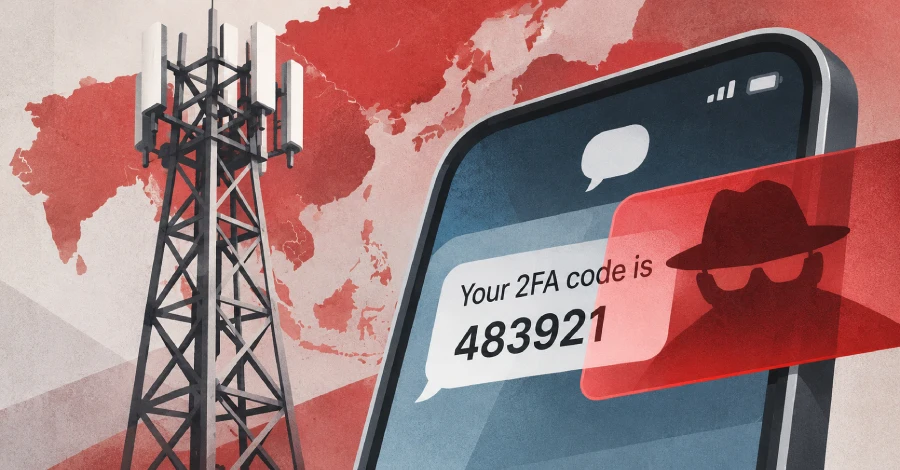
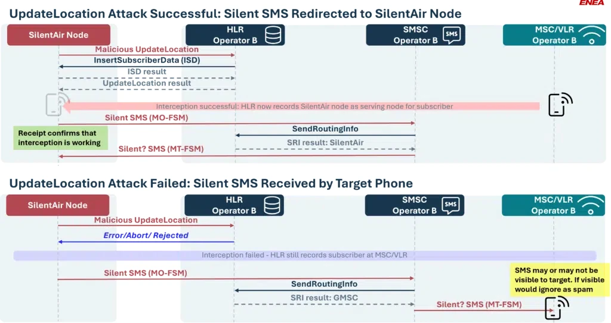

# SilentAir – Telecom Network Espionage Campaign

**Telecom Espionage**{.cve-chip}  
**SS7/Diameter Exploitation**{.cve-chip}  
**State-Sponsored**{.cve-chip}

## Overview

SilentAir is a suspected state-level cyber-espionage threat actor that compromised telecommunications infrastructure across multiple Asian countries to conduct covert surveillance and intercept mobile communications. The campaign primarily targeted Taiwan, focusing on government officials, political figures, and selected mobile subscribers. Rather than infecting individual smartphones, attackers exploited compromised telecommunications network equipment to manipulate signaling traffic and redirect communications. The operation enabled attackers to intercept SMS messages, obtain subscriber information, track mobile locations, and potentially capture SMS-based Two-Factor Authentication (2FA) codes, representing a significant threat to national security and critical infrastructure.

## Technical Specifications

| **Attribute** | **Details** |
|---------------|-------------|
| **Threat Actor** | SilentAir (suspected state-level) |
| **Attack Type** | Telecom Network Espionage / Signaling Protocol Exploitation |
| **Target Countries** | Taiwan (primary), 5+ additional Asian countries |
| **Primary Targets** | Government officials, political figures, mobile subscribers |
| **Exploited Protocols** | SS7 (Signaling System 7), Diameter signaling |
| **Network Layer** | IPX (IP Exchange) interconnection network |
| **Malicious Methods** | UpdateLocation messages, Diameter equivalent messages, Silent SMS |
| **Infrastructure Compromise** | Mobile operator equipment across multiple countries |
| **Attack Vector** | Telecommunications network signaling layer |
| **Authentication Bypass** | SMS-based 2FA interception and redirection |

## Affected Products

- Telecommunications equipment in mobile operators across Asian countries
- SS7 and Diameter signaling systems
- IPX (IP Exchange) network infrastructure
- Mobile subscriber accounts in affected regions
- SMS-based 2FA authentication systems
- Government and political communication systems
- Targeted entities:
  - Taiwan (primary target)
  - Six+ additional Asian countries

## Attack Scenario

1. Attackers gain unauthorized access to telecommunications equipment belonging to mobile operators in multiple Asian countries
2. They use the compromised equipment to send malicious SS7 and Diameter signaling messages through the IPX network
3. The messages impersonate legitimate subscriber location updates, attempting to redirect the victim's communications
4. When the victim's home network accepts the malicious update, incoming SMS messages are routed through the compromised equipment
5. Attackers intercept sensitive messages, including SMS-based 2FA authentication codes
6. They use Silent SMS messages to test and monitor whether the redirection remains active
7. The collected information can support further surveillance and attempts to compromise victims' online accounts
8. Attackers maintain persistent access to telecommunications infrastructure for continued monitoring

## Impact Assessment

=== "Confidentiality"
    * Unauthorized interception of SMS messages containing sensitive information
    * Exposure of subscriber location data and tracking information
    * Capture of SMS-based 2FA authentication codes
    * Disclosure of government communications and political conversations
    * Access to personal and business communications
    * Potential extraction of subscriber identities and phone numbers

=== "Integrity"
    * Compromise of telecommunications infrastructure trust relationships
    * Manipulation of signaling protocols (SS7 and Diameter)
    * Redirection of subscriber routing and communication paths
    * Potential alteration of subscriber service parameters
    * Compromise of inter-operator network integrity
    * Degradation of telecommunications network security controls

=== "Availability"
    * Potential disruption of mobile communication services for targeted subscribers
    * SMS delivery delays or failures due to traffic redirection
    * Degraded telecommunications network performance
    * Potential service unavailability during active redirection
    * Resource consumption from signaling traffic manipulation
    * Impact on emergency communication capabilities

## Mitigation Strategies

### Immediate Actions
- Deploy and strengthen SS7 and Diameter signaling firewalls across all network boundaries
- Implement GTP-C and GTP-U firewalls with comprehensive monitoring capabilities
- Review and validate all recent subscriber location updates and routing changes
- Audit IPX interconnection logs for suspicious signaling messages and patterns
- Block or restrict connections from suspected compromised equipment
- Monitor for Silent SMS activity and unusual SMS redirection patterns
- Activate enhanced signaling security monitoring and alerting systems

### Short-term Measures
- Conduct comprehensive security audit of telecommunications equipment and software
- Implement continuous monitoring and detection of suspicious signaling traffic
- Establish real-time alerting for unauthorized subscriber location updates
- Review and strengthen access controls for telecommunications equipment
- Implement subscriber notification procedures for potential compromise
- Deploy advanced anomaly detection systems for signaling protocols
- Coordinate with telecommunications regulatory authorities and other operators

### Monitoring & Detection
- Integrate telecommunications signaling security monitoring with enterprise SOC and SIEM platforms
- Monitor SS7 and Diameter traffic for indicators of compromise
- Track Silent SMS messages and analyze patterns for detection
- Implement deep packet inspection (DPI) for signaling protocol analysis
- Monitor subscriber routing changes for anomalies and unauthorized modifications
- Alert on unusual inter-operator signaling traffic and redirection attempts
- Correlate signaling data with subscriber access logs and authentication attempts
- Establish baseline behavior models for normal signaling activity

### Long-term Solutions
- Replace SMS-based 2FA with stronger authentication mechanisms such as FIDO2 security keys and passkeys for sensitive accounts
- Implement next-generation telecommunications network security architectures
- Apply security controls beyond basic industry signaling-security recommendations
- Establish government-level coordination for detecting cross-border telecom attacks
- Develop incident response procedures specific to telecommunications infrastructure
- Implement redundant signaling security controls and defense-in-depth strategies
- Conduct regular security assessments and penetration testing of signaling networks
- Establish sharing of threat intelligence among telecommunications operators
- Transition to more secure signaling protocols and network architectures
- Implement encryption for signaling messages end-to-end

## Resources and References

!!! info "Official Sources"
    - [SilentAir Hijacks Asian Telecom Networks to Intercept SMS 2FA Codes and Spy on Taiwanese Users | The Hacker News](https://thehackernews.com/2026/11/silentair-hijacks-asian-telecom.html)

---

*Last Updated: November 17, 2026*
