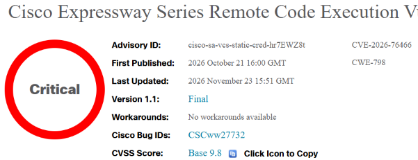

# Exploitation of Critical Cisco Expressway Remote Code Execution Vulnerability (CVE-2026-76466)

**CVE-2026-76466**{.cve-chip}  
**Remote Code Execution**{.cve-chip}  
**Cisco Expressway**{.cve-chip}

## Overview

Threat actors exploited a critical remote code execution vulnerability in Cisco Expressway (CVE-2026-76466) to compromise four devices belonging to a Russian organization. They initially accessed two internet-facing devices, then reached two additional cluster nodes on the organization's internal network. Following exploitation, the attackers obtained root privileges and prepared custom Python scripts for internal reconnaissance and searches for sensitive credentials and information.

The incident was reported by Russian cybersecurity company F6 shortly after proof-of-concept exploit code became publicly available.

## Technical Specifications

| **Attribute** | **Details** |
|---------------|-------------|
| **CVE ID** | CVE-2026-76466 |
| **CVSS Score** | 9.8 (Critical) |
| **Affected Product** | Cisco Expressway Series |
| **Vulnerability Type** | Remote Code Execution (RCE) |
| **Reported Weakness Classification** | CWE-798 |
| **Root Cause** | Persistent cookies and insufficient client certificate validation when TLS Verify Mode is enabled for clustering |
| **Affected Configurations** | Vulnerable clustered Expressway-C and Expressway-E deployments |
| **Privileges Obtained in Reported Incident** | Root-level access |
| **Reported Impact** | Four devices compromised |

## Affected Products

- Cisco Expressway Series running vulnerable releases
- Clustered deployments of Expressway-C and Expressway-E
- The reported intrusion affected four devices: two internet-facing devices and two additional internal cluster nodes

## Attack Scenario

1. Attackers exploited CVE-2026-76466 against two internet-facing Cisco Expressway devices.
2. Successful exploitation allowed operating-system command execution with root privileges.
3. Attackers used a compromised device to reach two additional cluster nodes inside the organization's network.
4. Custom Python scripts were prepared for internal reconnaissance and discovery of accessible resources, including SMB shares.
5. The attackers sought sensitive information and credentials in enterprise resources, including Microsoft SQL Server, WinRM, and GitLab.
6. The scripts could facilitate collection and potential exfiltration of sensitive information.

## Impact Assessment

=== "Integrity"
    * Unauthorized root-level access to Cisco Expressway devices
    * Potential modification of device configuration and services
    * Internal systems could be affected by activity originating from compromised cluster nodes

=== "Confidentiality"
    * Internal network resources were exposed to reconnaissance
    * Credentials and sensitive information in accessible enterprise systems were targeted
    * Potential data collection and exfiltration; the extent of confirmed data loss was not specified

=== "Availability"
    * Compromise could disrupt enterprise voice, video, and collaboration services
    * Activity across the cluster could affect availability of connected Expressway nodes
    * Expanded access could increase the risk of wider organizational disruption

## Mitigation Strategies

### Immediate Actions
- Upgrade Cisco Expressway X15.5.3 and earlier releases to X15.5.20 or a later fixed release
- Organizations running X14 or earlier should migrate to a fixed, supported release
- If immediate patching is not possible, restrict TCP ports 4371–4372 to trusted cluster nodes
- Isolate suspected compromised devices and preserve evidence for forensic investigation

### Short-term Measures
- Review the Erlang system log (`erlang.log`) for suspicious entries, including `wombat@127.0.0.1`
- Investigate suspicious Python scripts staged under `/mnt/harddisk/i{0-9}{4}[a-zA-Z]?/*.py`
- Review SMB, SQL Server, WinRM, and GitLab access logs for suspicious activity
- Rotate potentially compromised credentials and authentication secrets
- Investigate connections involving the IP addresses identified in the Cisco advisory; no IP addresses were included in the supplied incident details

### Monitoring & Detection
- Monitor Expressway logs for unexpected authentication, clustering, and administrative activity
- Alert on unexplained connections to TCP ports 4371–4372
- Hunt for suspicious Python scripts and internal reconnaissance activity from Expressway devices
- Review network traffic and access logs for activity from compromised perimeter devices to internal resources

### Long-term Solutions
- Keep Cisco Expressway deployments on supported, fixed releases
- Restrict cluster communication to trusted nodes and segment collaboration infrastructure from other internal systems
- Regularly review credentials and secrets stored in enterprise repositories and services
- Include Expressway cluster nodes in routine vulnerability management and incident response procedures

## Resources and References

!!! info "Security Advisories"
    - [Hackers Exploit Critical Cisco Expressway Flaw, Breach Four Devices and Reach Internal Network | The Hacker News](https://thehackernews.com/2026/11/hackers-exploit-critical-cisco.html)
    - [Cisco Expressway Series Remote Code Execution Vulnerability | Cisco](https://www.cisco.com/c/en/us/support/docs/csa/cisco-sa-vcs-static-cred-hr7EWZ8t.html)

---

*Last Updated: November 24, 2026*
