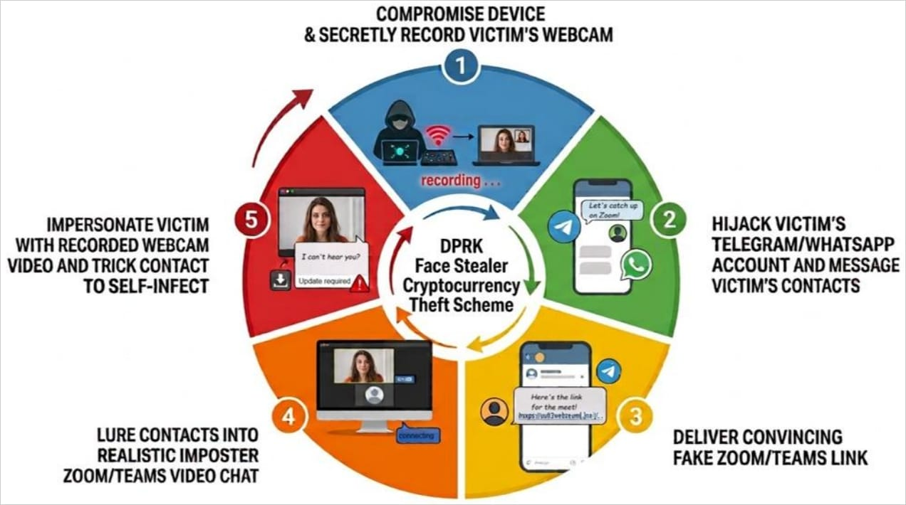
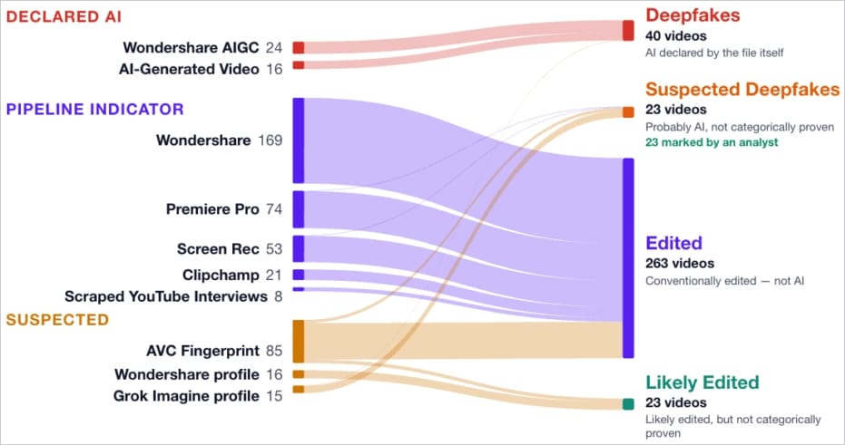

# FaceStealer – North Korean Cryptocurrency Theft and Social Engineering Campaign

**Cryptocurrency Theft**{.cve-chip}  
**Social Engineering**{.cve-chip}  
**Deepfake Impersonation**{.cve-chip}

## Overview

On November 12, 2026, the U.S. Department of Justice and FBI announced the disruption of FaceStealer, a North Korean-linked cyber campaign that stole more than $400 million in cryptocurrency. The operators reportedly took over accounts belonging to previous victims on Telegram, LinkedIn, Slack, and Discord, then used those trusted identities to invite targets to fake video meetings.

During the meetings, attackers used recorded webcam footage and AI-generated or manipulated videos to impersonate trusted contacts and cryptocurrency-industry figures. They then persuaded victims to download or run malware under the pretense of fixing technical problems. The campaign also targeted open-source software developers and maintainers, creating potential supply-chain risk.

## Technical Specifications

| **Attribute** | **Details** |
|---------------|-------------|
| **Campaign Name** | FaceStealer |
| **Threat Actor Attribution** | North Korean-linked groups |
| **Groups Reportedly Associated** | Sapphire Sleet, UNC1069, Dangerous Password, CryptoCore, APT38, BlueNoroff, and Stardust Chollima |
| **Primary Objective** | Cryptocurrency theft and credential collection |
| **Social Engineering** | Hijacked communications accounts, fake meeting invitations, and deepfake impersonation |
| **Delivery Lure** | Fake video-conferencing sites and fabricated technical fixes |
| **Reported Theft** | More than $400 million in cryptocurrency |
| **Reported Campaign Period** | Approximately 18 months |
| **Additional Targeting** | Open-source developers and software supply chains |

## Affected Products

- Cryptocurrency holders and organizations, including people in the cryptocurrency industry
- Users of Telegram, LinkedIn, Slack, and Discord whose accounts or contacts were targeted
- Users tricked into visiting fake video-conferencing sites or installing purported fixes
- Open-source software developers, maintainers, and potentially downstream users of their projects
- Developer and source-code repository accounts

## Attack Scenario

1. Attackers compromised legitimate communication accounts belonging to previous victims.
2. They used those accounts to send convincing invitations to potential targets.
3. Targets were directed to fraudulent video meetings impersonating familiar people or legitimate conferencing services.
4. Recorded footage or deepfake videos were used to build trust.
5. A fabricated technical issue was introduced, and the target was encouraged to install software or follow unsafe instructions.
6. The resulting malware could steal credentials and cryptocurrency-related information.
7. Compromised contacts and accounts were used to identify and approach additional targets.
8. In some reported cases, attackers delayed cryptocurrency theft for months or longer after the initial compromise.
9. Developers and maintainers were also targeted, raising the risk of compromise to software projects and their users.

## Impact Assessment

=== "Confidentiality"
    * More than $400 million in cryptocurrency was reportedly stolen
    * Communication-account credentials and other sensitive information were targeted
    * Secret webcam recording created privacy risks for victims
    * Compromised accounts could expose conversations, contact lists, and professional relationships

=== "Integrity"
    * Hijacked accounts could be used to impersonate victims and send fraudulent messages
    * Developer devices or repository accounts could be abused to alter source code
    * Malicious code introduced into software projects could affect downstream users
    * Cryptocurrency transactions could be initiated without the owner's authorization

=== "Availability"
    * Compromised communication accounts could be locked, disrupted, or misused
    * Malware infections could impair affected devices and require recovery
    * A software supply-chain compromise could disrupt projects and services that depend on affected software

## Mitigation Strategies

### Immediate Actions
- Do not run commands, scripts, or downloads requested during unexpected video meetings
- Verify meeting invitations and unusual requests through an independent, trusted communication channel
- Use official video-conferencing applications and websites rather than links supplied by unexpected contacts
- If compromise is suspected, isolate the affected device, preserve evidence, and contact the organization's security team
- Review cryptocurrency accounts and wallets for unauthorized activity

### Short-term Measures
- Enable phishing-resistant multi-factor authentication (MFA) on communication, developer, and financial accounts
- Review account sessions, connected devices, recovery options, and third-party application permissions
- Change credentials that may have been exposed and revoke suspicious sessions or tokens
- Use endpoint detection and response (EDR) tools to investigate suspicious software and activity
- Restrict administrative privileges and monitor suspicious command-line activity

### Monitoring & Detection
- Monitor endpoints for unexpected software installations and unusual command-line activity
- Review communication accounts for unfamiliar sessions, messages, and application authorizations
- Monitor cryptocurrency transactions and wallet activity for unauthorized transfers
- Audit source-code repositories for unexpected changes, new credentials, or unfamiliar collaborators
- Investigate unusual developer-account access and software publishing activity

### Long-term Solutions
- Secure developer and repository accounts with hardware security keys and least-privilege access
- Require independent code review and dependency checks before publishing software updates
- Protect software-signing and publishing credentials and rotate them when exposure is suspected
- Provide security awareness training on deepfake-enabled impersonation and fake technical-support requests
- Maintain offline or securely isolated backups of critical systems and digital assets
- Establish incident-response procedures for account takeover, endpoint compromise, and software supply-chain incidents

## Resources and References

!!! info "Official Sources and Reporting"
    - [US disrupts North Korean campaign behind $400 million crypto theft | BleepingComputer](https://www.bleepingcomputer.com/news/security/us-disrupts-north-korean-campaign-behind-400-million-crypto-theft/)
    - [Justice Department Announces Actions to Disrupt North Korea’s Massive Theft of Cryptocurrency | U.S. Department of Justice](https://www.justice.gov/opa/pr/justice-department-announces-actions-disrupt-north-koreas-massive-theft-cryptocurrency)

---

*Last Updated: November 24, 2026*
