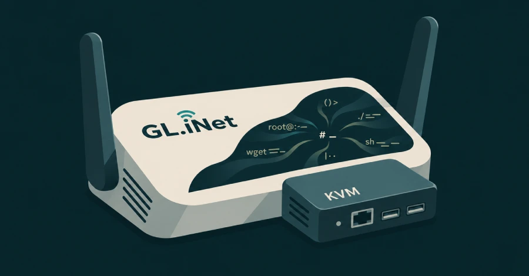

# GL.iNet GoodCloud Cloud Management Platform Exploitation – Router and KVM Malware Infection

**Cloud Management Exploitation**{.cve-chip}  
**Router and KVM Malware**{.cve-chip}  
**Remote Command Execution**{.cve-chip}

## Overview

GL.iNet disclosed an incident involving exploitation of vulnerabilities in its GoodCloud remote management service. Attackers abused unauthorized access to the cloud management infrastructure to send management messages to other users' connected devices. On affected routers, an input-handling vulnerability in the AstroWarp/SD-WAN component could allow those inputs to execute as shell commands with root privileges, even when AstroWarp was disabled. A separate certificate-verification weakness affected some KVM devices.

Attackers were observed deploying malicious scripts and programs, scanning local networks, and establishing reverse-shell connections. GL.iNet blocked the identified attack path on November 20, 2026, and released security firmware. The total number of compromised devices remains unknown. CVE identifiers were pending at the time of the November 23 security notice.

## Technical Specifications

| **Attribute** | **Details** |
|---------------|-------------|
| **Incident Type** | Cloud management platform exploitation and malware infection |
| **Affected Service** | GL.iNet GoodCloud remote management |
| **MQTT Component** | EMQX-based messaging service with an authorization misconfiguration |
| **Affected Devices** | Some GL.iNet routers and KVM devices |
| **Router Vulnerability** | Insufficient input validation in the AstroWarp/SD-WAN component could allow root-level command execution |
| **KVM Issue** | RTTY/TLS server certificate verification weakness |
| **Observed Activity** | Malware deployment, local network scanning, and reverse-shell connections |
| **CVE Status** | Identifiers pending as of the November 23, 2026 notice |
| **Attack Path Blocked** | November 20, 2026 |
| **Compromised Device Count** | Unknown |

## Affected Products

- Some GL.iNet routers connected to GoodCloud
- Some GL.iNet KVM devices
- The affected router and KVM models and firmware versions were not specified in the supplied advisory summary; check GL.iNet's security notice for model-specific details

## Attack Scenario

1. Attackers exploited an authorization misconfiguration in GoodCloud's MQTT messaging service.
2. They sent unauthorized management messages to GL.iNet devices belonging to other users.
3. On vulnerable routers, insufficient input validation in the AstroWarp/SD-WAN component could allow management input to execute as root-level shell commands.
4. Attackers deployed malware and attempted to establish reverse-shell connections for remote access.
5. On some KVM devices, attackers downloaded malicious scripts or programs, scanned local networks, and made suspicious external connections.
6. Compromised devices could potentially be used for further network reconnaissance or unauthorized access.

## Impact Assessment

=== "Integrity"
    * Unauthorized root-level access to affected routers
    * Malware installation and modification of device behavior
    * Potential manipulation of router configuration and management functions
    * Potential exposure of connected network environments to reconnaissance

=== "Confidentiality"
    * Administrative credentials, VPN configurations, SSH keys, and other device-stored secrets may be exposed
    * Local network reconnaissance could reveal information about connected systems
    * Computers connected to affected KVM devices may face risk, although access to those computers has not been confirmed
    * The extent of any data exposure remains unknown

=== "Availability"
    * Malware and unauthorized remote access could disrupt device operation
    * Network security and remote device management operations may be affected
    * Recovery may require reinstalling firmware and manually reconfiguring devices
    * The number of affected devices is unknown

## Mitigation Strategies

### Immediate Actions
- Install the latest security firmware released by GL.iNet for the exact router or KVM model
- If immediate updating is not possible, disable GoodCloud until the device is updated, provided a secure alternative management method is available
- For suspected compromise, preserve available forensic evidence before rebooting or updating where feasible
- Monitor network traffic and investigate suspicious outbound connections and unexpected administrative activity

### Short-term Measures
- For confirmed or suspected compromise, reinstall official security firmware without retaining previous settings, then manually reconfigure the device
- Change administrative passwords and replace VPN and SSH keys stored on or accessible from potentially compromised devices
- Avoid restoring configuration backups from potentially compromised devices
- Inspect connected computers for unfamiliar accounts, software, browser extensions, startup items, and suspicious network activity, particularly when using affected KVM devices
- Review device access, management settings, and recent configuration changes

### Monitoring & Detection
- Monitor for suspicious outbound connections and unexpected reverse-shell activity
- Review device logs for unfamiliar management messages, administrative actions, and configuration changes
- Look for local network scanning originating from routers or KVM devices
- Investigate unusual external communications from affected devices
- Monitor GL.iNet security notices for model-specific indicators and remediation updates

### Long-term Solutions
- Keep router and KVM firmware current and apply model-specific security updates promptly
- Disable cloud management features that are not required for operations
- Restrict administrative interfaces and management access to trusted networks
- Use unique administrative passwords and rotate credentials and keys after suspected exposure
- Maintain known-good configuration backups separately from potentially compromised devices
- Include network appliances and KVM devices in routine security monitoring and incident response procedures

## Resources and References

!!! info "Security Reporting"
    - [Hackers Exploited GL.iNet Cloud Flaw to Install Malware on Routers and KVM Devices | The Hacker News](https://thehackernews.com/2026/11/hackers-exploited-glinet-cloud-flaw-to.html)

---

*Last Updated: November 24, 2026*
