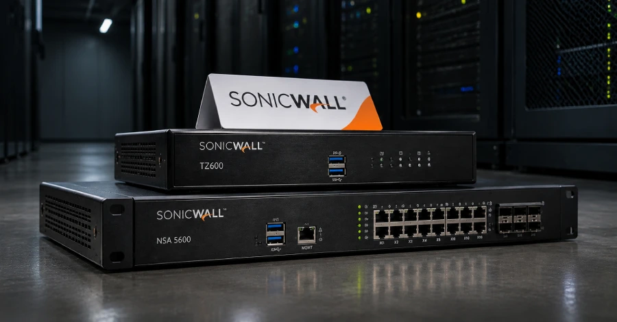

# SonicWall Gen 6 Firewall End-of-Life (EOL) Security Warning

**End-of-Life Firewalls**{.cve-chip}  
**Unsupported SonicOS 6.x**{.cve-chip}  
**Network Security Risk**{.cve-chip}

## Overview

SonicWall warned customers to retire and replace Generation 6 and Generation 6.5 firewalls running SonicOS 6.x. These devices have reached end of support and will no longer receive firmware updates or security patches, including for future critical vulnerabilities. SonicWall expects internet-facing Gen 6 firewalls to attract automated attacks, potentially accelerated by AI-assisted vulnerability analysis.

The company recommends migrating to supported Gen 8 firewalls running SonicOS 8. SonicWall cited CVE-2024-40766 (CVSS 9.3), a previously exploited vulnerability affecting certain SonicWall firewall devices, as an example of the risk to exposed network security appliances. This CVE is an example of prior risk, not a CVE assigned to the end-of-life warning.

## Technical Specifications

| **Attribute** | **Details** |
|---------------|-------------|
| **Issue Type** | End-of-life hardware and unsupported firmware |
| **Affected Generation** | SonicWall Gen 6 and Gen 6.5 |
| **Affected Firmware** | SonicOS 6.x |
| **Support Status** | End of support; no future firmware updates or security patches |
| **Exposure Concern** | Internet-facing devices may be targeted by automated attacks |
| **Referenced Vulnerability** | CVE-2024-40766, CVSS 9.3; previously exploited on certain SonicWall devices |
| **Recommended Migration** | Supported Gen 8 firewalls running SonicOS 8 |

## Affected Products

Gen 6 and Gen 6.5 firewalls running SonicOS 6.x, including:

- TZ300, TZ350, TZ400, TZ500, and TZ600
- SOHO 250
- NSA 2600, NSA 3600, NSA 4600, NSA 5600, and NSA 6600
- NSa 2650, NSa 3650, NSa 4650, NSa 5650, and NSa 6650
- SuperMassive 9200–9800
- NSsp 12400 and NSsp 12800
- NSv 10–1600

## Attack Scenario

The following is a potential risk scenario for exposed, unsupported devices; it does not assert that every listed step has occurred in this end-of-life warning:

1. Attackers scan internet-facing systems and identify exposed Gen 6 firewalls.
2. They determine device models and potentially vulnerable services or firmware versions.
3. They analyze public vulnerability disclosures and patches to identify weaknesses that may remain unpatched on unsupported devices.
4. They may attempt to exploit an identified weakness to gain unauthorized firewall access.
5. A successful compromise could provide a foothold into the organization's internal network.
6. Attackers could then attempt credential theft, lateral movement, or deployment of ransomware.

## Impact Assessment

=== "Integrity"
    * Firewall configurations and security policies could be modified
    * Unauthorized changes could weaken network access controls
    * Attackers with firewall access could alter routing or security settings

=== "Confidentiality"
    * Sensitive organizational information and network traffic could be exposed
    * Credentials and remote-access information could be targeted
    * A firewall compromise could facilitate access to internal systems

=== "Availability"
    * Network connectivity and VPN services could be disrupted
    * A compromised firewall could affect access to connected business systems
    * Ransomware or other malicious activity could interrupt business operations

## Mitigation Strategies

### Immediate Actions
- Inventory Gen 6 and Gen 6.5 firewalls and prioritize replacement, especially for internet-facing devices
- Migrate to a supported Gen 8 firewall running SonicOS 8
- Until replacement, disable WAN management services, including HTTPS, SSH, and SNMP
- Disable SSL VPN or restrict access to trusted source IP addresses

### Short-term Measures
- Enforce multi-factor authentication (MFA) for administrative and remote-access accounts
- Reset local administrative passwords
- Disable unused services and interfaces
- Review firewall access policies and network segmentation

### Monitoring & Detection
- Monitor firewall logs for suspicious login attempts and unusual administrative activity
- Alert on unauthorized configuration changes
- Review network traffic for unexpected connections or activity from exposed devices
- Investigate indicators of compromise promptly and follow SonicWall guidance

### Long-term Solutions
- Replace unsupported firewalls with supported models and maintain a firmware update plan
- Maintain an accurate inventory of network security appliances and their support status
- Limit management interfaces to trusted networks and apply least-privilege access
- Review network segmentation and remote-access controls regularly

## Resources and References

!!! info "Security Advisories"
    - [SonicWall Warns Gen 6 Firewalls Won't Get Security Patches, Even for Critical Flaws | The Hacker News](https://thehackernews.com/2026/11/sonicwall-warns-gen-6-firewalls-wont.html)
    - [Product Advisory: Retire Unsupported Gen 6 Firewalls | SonicWall](https://www.sonicwall.com/support/notices/kA1VN000002iouP0AQ)

---

*Last Updated: November 24, 2026*
