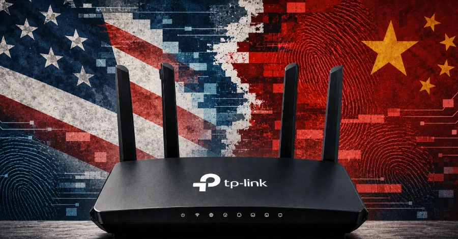
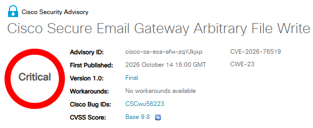
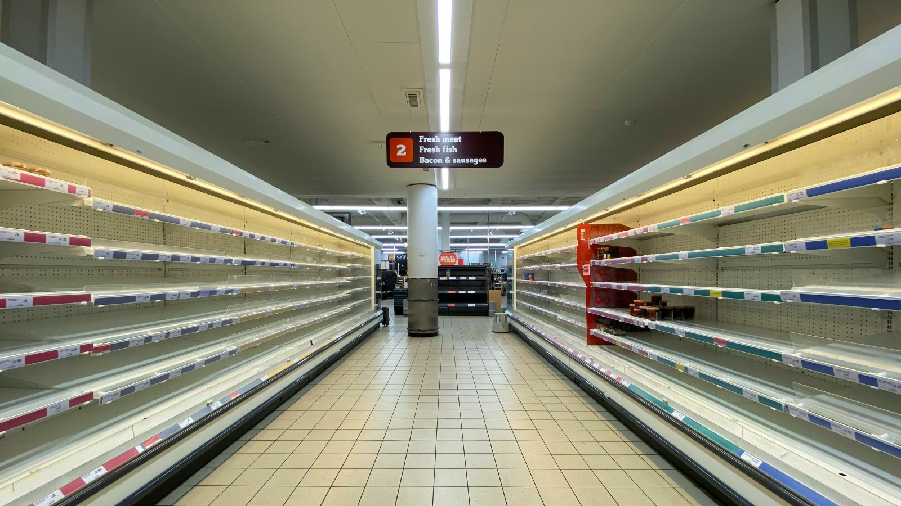

---
hide:
  - navigation
  - toc
---

# Last Week's Security Incidents
 

-   {.index-card__img}

    **FortiBleed Campaign**

    **FortiBleed**{.cve-chip} **FortiGate**{.cve-chip} **SSL VPN**{.cve-chip} **Credential Attacks**{.cve-chip} **Firewall Intrusion**{.cve-chip}

    A campaign targeting internet-facing FortiGate and SSL VPN services through stolen or reused credentials, with risks of persistent access and internal-network intrusion.

    [Read more →](2026/Week41/FortiBleed.md){.index-card__cta}

-   {.index-card__img}

    **TP-Link Faces Lawsuits Over Router Security, Privacy, and China-Related Concerns**

    **TP-Link**{.cve-chip} **Router Security**{.cve-chip} **Aginet CVEs**{.cve-chip} **State Lawsuits**{.cve-chip} **Privacy Risk**{.cve-chip}

    New U.S. state lawsuits and disclosed Aginet vulnerabilities raise combined legal, security, and supply-chain concerns for affected router deployments.

    [Read more →](2026/Week41/TP-Link.md){.index-card__cta}

-   {.index-card__img}

    **Hirudo Android Banking Trojan**

    **Hirudo**{.cve-chip} **Android Trojan**{.cve-chip} **App Replacement**{.cve-chip} **Credential Theft**{.cve-chip} **Accessibility Abuse**{.cve-chip}

    Hirudo replaces legitimate banking apps with trojanized versions, abuses Android permissions, and steals credentials, PINs, and session-relevant data for fraud.

    [Read more →](2026/Week41/Hirudo.md){.index-card__cta}

-   {.index-card__img}

    **Cisco Secure Email Gateway Arbitrary File Write Vulnerability - CVE-2026-76519**

    **Cisco SEG**{.cve-chip} **CVE-2026-76519**{.cve-chip} **CWE-23**{.cve-chip} **CVSS 9.8**{.cve-chip} **Active Exploitation**{.cve-chip}

    Cisco disclosed active exploitation of a critical Secure Email Gateway flaw that can allow unauthenticated attachment-driven arbitrary file writes and potential root-level execution.

    [Read more →](2026/Week41/Cisco.md){.index-card__cta}

-   {.index-card__img}

    **Cyberattack Disrupts Refrigeration at French Supermarkets**

    **French Retail**{.cve-chip} **Refrigeration Controls**{.cve-chip} **Danfoss Context**{.cve-chip} **Cold-Chain Risk**{.cve-chip} **Operational Disruption**{.cve-chip}

    Reported unauthorized defrost-trigger activity disrupted refrigeration at multiple French supermarket chains, forcing product-removal precautions and incident investigation.

    [Read more →](2026/Week41/Supermarkets.md){.index-card__cta}

-   {.index-card__img}

    **CyberXero AI-Assisted Intrusions and Ukrainian Data Theft**

    **CyberXero**{.cve-chip} **AI-Assisted Intrusions**{.cve-chip} **WordPress Targeting**{.cve-chip} **628K+ Records**{.cve-chip} **IAB Activity**{.cve-chip}

    Researchers reported an ongoing campaign blending automated global exploitation with selective targeting of Ukrainian organizations, with confirmed exfiltration evidence from multiple victims.

    [Read more →](2026/Week41/CyberXero.md){.index-card__cta}

-   {.index-card__img}

    **Exploitation Attempts Against SonicWall SMA 1000 SSRF Vulnerability**

    **SonicWall SMA 1000**{.cve-chip} **CVE-2026-102255**{.cve-chip} **Pre-Auth SSRF**{.cve-chip} **CVSS 10.0**{.cve-chip} **Observed Attempts**{.cve-chip}

    Researchers reported exploitation attempts against a critical pre-auth SSRF flaw in SMA 1000 appliances shortly after patch release, while public reporting has not verified production compromise.

    [Read more →](2026/Week41/SonicWall.md){.index-card__cta}

