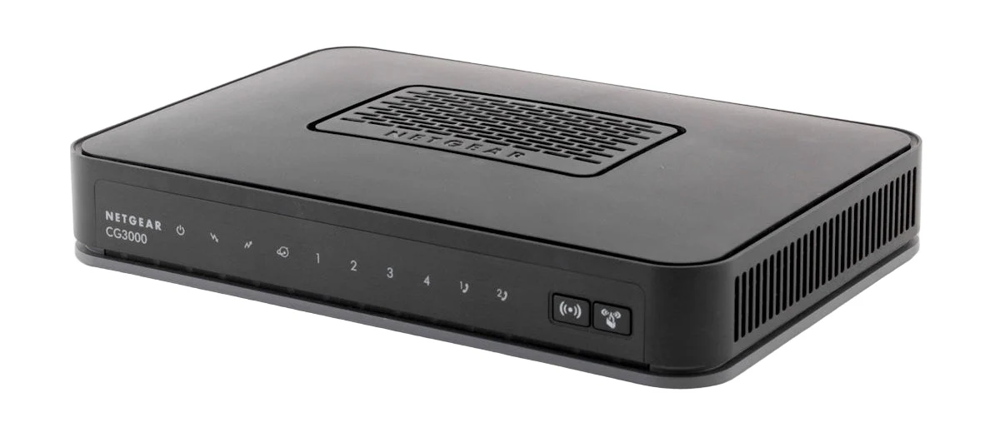
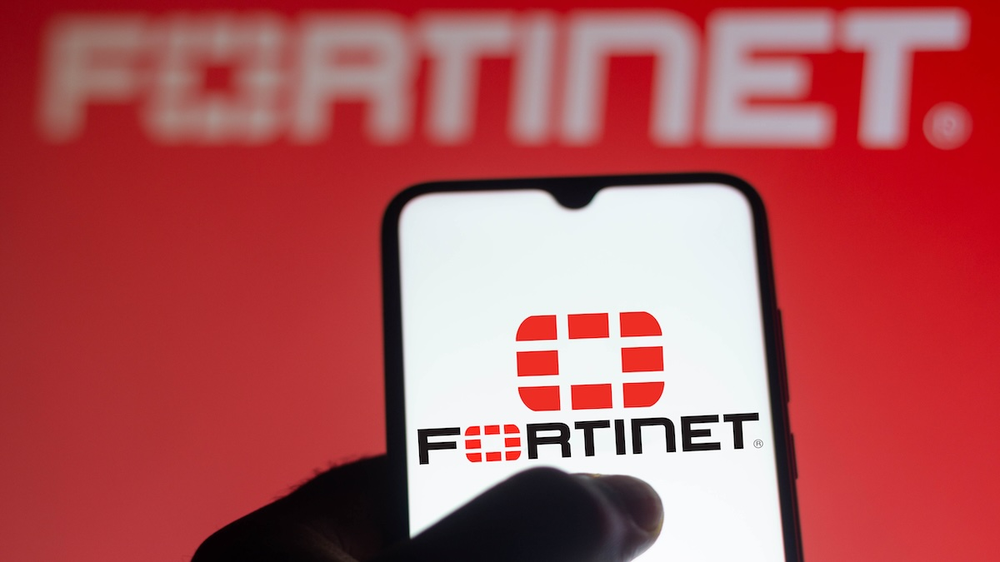

---
hide:
  - toc
---

Security Operations Briefing

# Incidents

A living, day-by-day catalogue of cybersecurity incidents, vulnerabilities, malware campaigns, and threat-actor activity — each entry a standalone briefing on what happened, what's affected, and what to do about it.

<!--INDEX_DATE-->Tuesday, October 20, 2026<!--/INDEX_DATE-->

-   {.index-card__img}

    **Potential AI-Powered Self-Propagating IoT Botnets**

    **AI Botnets**{.cve-chip} **IoT Security**{.cve-chip} **Self-Propagation Risk**{.cve-chip} **Distributed Inference**{.cve-chip} **Research Warning**{.cve-chip}

    Research warns that small AI models may eventually replicate across insecure IoT fleets, potentially enabling distributed botnet-style inference operations.

    [Read more →](2026/Week42/Botnets.md){.index-card__cta}

-   {.index-card__img}

    **WPSplinter - Broadcom Wi-Fi / WPS Implementation Vulnerability**

    **WPSplinter**{.cve-chip} **Broadcom Wi-Fi**{.cve-chip} **WPS/EAP**{.cve-chip} **Unauthenticated RCE**{.cve-chip} **Wireless Proximity**{.cve-chip}

    A long-standing Broadcom WPS reassembly flaw may allow nearby attackers to trigger memory corruption and potentially execute code on vulnerable routers without authentication.

    [Read more →](2026/Week42/WPSplinter.md){.index-card__cta}

-   {.index-card__img}

    **Fortinet Vulnerability Exploitation and PeerStitch FortiGate Implant**

    **Fortinet**{.cve-chip} **CVE-2024-47575**{.cve-chip} **CVE-2025-61624**{.cve-chip} **PeerStitch**{.cve-chip} **UNC5820**{.cve-chip}

    A telecom intrusion linked to UNC5820 reportedly leveraged FortiManager and FortiGate vulnerabilities to deploy the in-memory PeerStitch implant and maintain covert persistence.

    [Read more →](2026/Week42/Fortinet.md){.index-card__cta}

<footer class="index-footer" markdown>

published by EG-ETCS team on GitHub

<nav class="index-footer__nav" markdown>

[Organization](https://github.com/EG-ETCS){.index-footer__link}

[Incidents Repo](https://github.com/EG-ETCS/Incidents){.index-footer__link}

</nav>

</footer>

