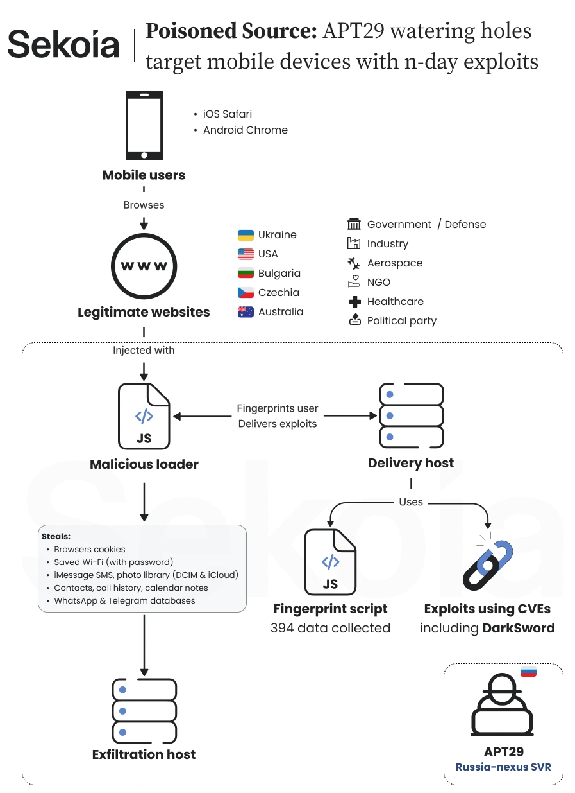
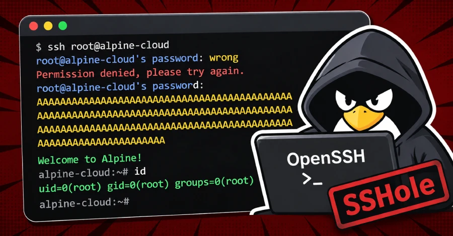

---
hide:
  - toc
---

Security Operations Briefing

# Incidents

A living, day-by-day catalogue of cybersecurity incidents, vulnerabilities, malware campaigns, and threat-actor activity — each entry a standalone briefing on what happened, what's affected, and what to do about it.

<!--INDEX_DATE-->Thursday, November 12, 2026<!--/INDEX_DATE-->

-   {.index-card__img}

    **Critical Android Zero-Click Remote Code Execution Vulnerability**

    **Android**{.cve-chip} **CVE-2026-58868**{.cve-chip} **Zero-Click**{.cve-chip} **Heap Overflow**{.cve-chip} **Framework**{.cve-chip}

    Google patched a critical Android framework flaw that may enable remote code execution on Android 14 to 17 without user interaction.

    [Read more →](2026/Week45/Android.md){.index-card__cta}

-   {.index-card__img}

    **APT29 Mobile Watering Hole Campaign**

    **APT29**{.cve-chip} **iOS/Android Exploits**{.cve-chip} **Watering Hole**{.cve-chip} **Plerdy Supply-Chain**{.cve-chip} **Data Exfiltration**{.cve-chip}

    Sekoia-reported activity used compromised sites and analytics supply chain access to fingerprint mobile visitors and deliver targeted exploit chains.

    [Read more →](2026/Week45/APT29.md){.index-card__cta}

-   {.index-card__img}

    **OpenSSH SSHole Authentication Bypass**

    **OpenSSH**{.cve-chip} **CVE-2026-123158**{.cve-chip} **SSHole**{.cve-chip} **Auth Bypass**{.cve-chip} **musl/PAM Condition**{.cve-chip}

    A conditional OpenSSH flaw in musl-based environments can mis-handle failed password hashing and allow unauthorized SSH login bypass under specific account states.

    [Read more →](2026/Week45/OpenSSH.md){.index-card__cta}

-   {.index-card__img}

    **Multiple Zero-Day Vulnerabilities in D-Link DGS-3130 Series Managed Switches**

    **D-Link DGS-3130**{.cve-chip} **Zero-Day**{.cve-chip} **DDP Weaknesses**{.cve-chip} **Switch Security**{.cve-chip} **Patch Pending**{.cve-chip}

    D-Link disclosed multiple unpatched DGS-3130 weaknesses that can expose management data and enable unauthorized switch operations from reachable network segments.

    [Read more →](2026/Week45/D-Link.md){.index-card__cta}

<footer class="index-footer" markdown>

published by EG-ETCS team on GitHub

<nav class="index-footer__nav" markdown>

[Organization](https://github.com/EG-ETCS){.index-footer__link}

[Incidents Repo](https://github.com/EG-ETCS/Incidents){.index-footer__link}

</nav>

</footer>

