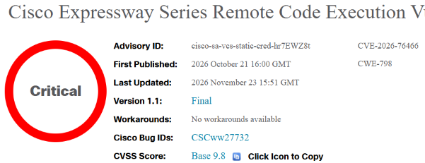

---
hide:
  - toc
---

Security Operations Briefing

# Incidents

A living, day-by-day catalogue of cybersecurity incidents, vulnerabilities, malware campaigns, and threat-actor activity — each entry a standalone briefing on what happened, what's affected, and what to do about it.

<!--INDEX_DATE-->Wednesday, November 25, 2026<!--/INDEX_DATE-->

-   {.index-card__img}

    **GL.iNet GoodCloud Cloud Management Platform Exploitation – Router and KVM Malware Infection**

    **Cloud Management Exploitation**{.cve-chip} **Router and KVM Malware**{.cve-chip} **Remote Command Execution**{.cve-chip}

    Attackers abused an authorization flaw in GL.iNet GoodCloud to send malicious management messages to routers and KVM devices, leading to malware deployment and unauthorized remote access. The affected device count remains unknown.

    [Read more →](2026/Week47/GLiNet.md){.index-card__cta}

-   {.index-card__img}

    **SonicWall Gen 6 Firewall End-of-Life (EOL) Security Warning**

    **End-of-Life Firewalls**{.cve-chip} **Unsupported SonicOS 6.x**{.cve-chip} **Network Security Risk**{.cve-chip}

    SonicWall Gen 6 and 6.5 firewalls running SonicOS 6.x will no longer receive security updates. SonicWall recommends replacing them with supported Gen 8 devices.

    [Read more →](2026/Week47/SonicWall.md){.index-card__cta}

-   {.index-card__img}

    **Exploitation of Critical Cisco Expressway Remote Code Execution Vulnerability (CVE-2026-76466)**

    **CVE-2026-76466**{.cve-chip} **Remote Code Execution**{.cve-chip} **Cisco Expressway**{.cve-chip}

    Attackers exploited a critical Cisco Expressway flaw to gain root access on four devices, move from internet-facing systems to internal cluster nodes, and conduct reconnaissance.

    [Read more →](2026/Week47/Cisco.md){.index-card__cta}

-   {.index-card__img}

    **FaceStealer – North Korean Cryptocurrency Theft and Social Engineering Campaign**

    **Cryptocurrency Theft**{.cve-chip} **Social Engineering**{.cve-chip} **Deepfake Impersonation**{.cve-chip}

    The campaign reportedly stole more than $400 million in cryptocurrency using hijacked accounts, fake video meetings, deepfake impersonation, and malware disguised as technical fixes.

    [Read more →](2026/Week47/FaceStealer.md){.index-card__cta}

<footer class="index-footer" markdown>

published by EG-ETCS team on GitHub

<nav class="index-footer__nav" markdown>

[Organization](https://github.com/EG-ETCS){.index-footer__link}

[Incidents Repo](https://github.com/EG-ETCS/Incidents){.index-footer__link}

</nav>

</footer>

