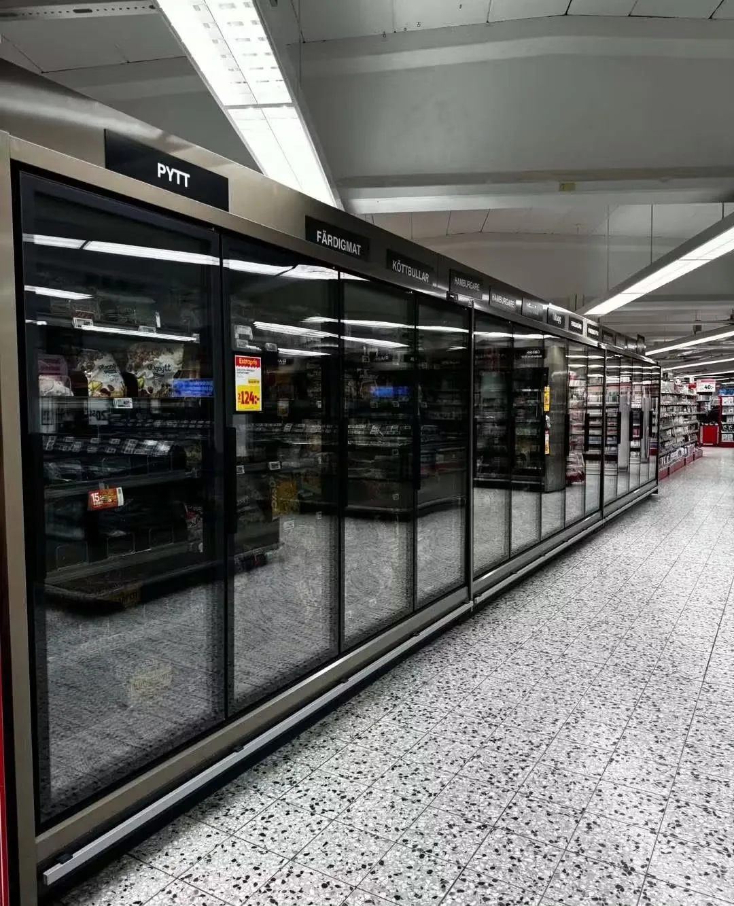
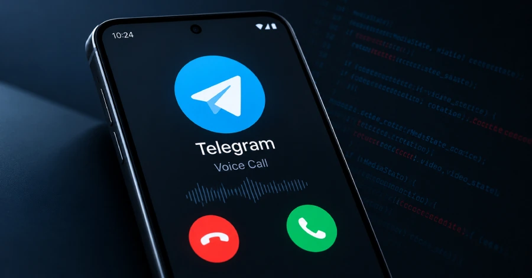
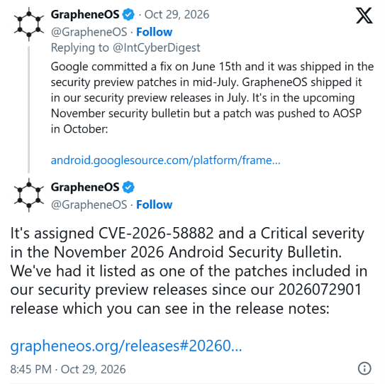

---
hide:
  - toc
---

Security Operations Briefing

# Incidents

A living, day-by-day catalogue of cybersecurity incidents, vulnerabilities, malware campaigns, and threat-actor activity — each entry a standalone briefing on what happened, what's affected, and what to do about it.

<!--INDEX_DATE-->Sunday, November 8, 2026<!--/INDEX_DATE-->

-   {.index-card__img}

    **European Supermarket Refrigeration System Cyberattacks**

    **OT Security**{.cve-chip} **Retail Infrastructure**{.cve-chip} **Forced Defrost Abuse**{.cve-chip} **Credential Risk**{.cve-chip} **Food-Safety Impact**{.cve-chip}

    Coordinated attacks reportedly manipulated refrigeration controls across multiple European supermarket chains, causing temperature spikes and operational disruption.

    [Read more →](2026/Week44/Supermarket.md){.index-card__cta}

-   {.index-card__img}

    **Google Disrupts a Botnet Affecting More Than 1.3 Million Android TV Devices**

    **XCPE Botnet**{.cve-chip} **Android TV**{.cve-chip} **Firmware Backdoor**{.cve-chip} **MQTT C2**{.cve-chip} **Supply-Chain Risk**{.cve-chip}

    Google and partners reported disruption of a large Android TV botnet tied to persistent firmware-level backdoor behavior and downstream criminal abuse.

    [Read more →](2026/Week44/Google.md){.index-card__cta}

-   {.index-card__img}

    **Telegram Android Voice Call Vulnerability - Remote Code Execution (RCE).**

    **Telegram Android**{.cve-chip} **Voice Calls**{.cve-chip} **Potential RCE**{.cve-chip} **No CVE Assigned**{.cve-chip} **Patched in 12.10.4**{.cve-chip}

    A Telegram Android call-handling flaw in MediaState processing may allow code execution after a victim answers a maliciously crafted voice call.

    [Read more →](2026/Week44/Telegram.md){.index-card__cta}

-   {.index-card__img}

    **Android SMS of Death - CVE-2026-58882**

    **Android**{.cve-chip} **WAP Push**{.cve-chip} **CVE-2026-58882**{.cve-chip} **Zero-Click**{.cve-chip} **Telephony DoS**{.cve-chip}

    A crafted invisible WAP Push SMS can crash Android telephony services with no user interaction, causing call disruption and potential emergency-call impact.

    [Read more →](2026/Week44/Android.md){.index-card__cta}

<footer class="index-footer" markdown>

published by EG-ETCS team on GitHub

<nav class="index-footer__nav" markdown>

[Organization](https://github.com/EG-ETCS){.index-footer__link}

[Incidents Repo](https://github.com/EG-ETCS/Incidents){.index-footer__link}

</nav>

</footer>

