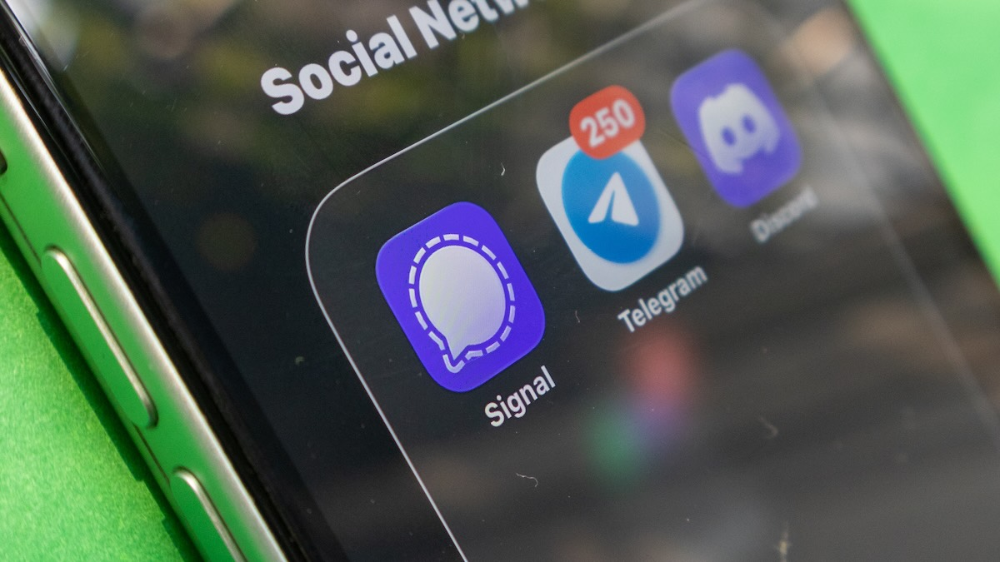
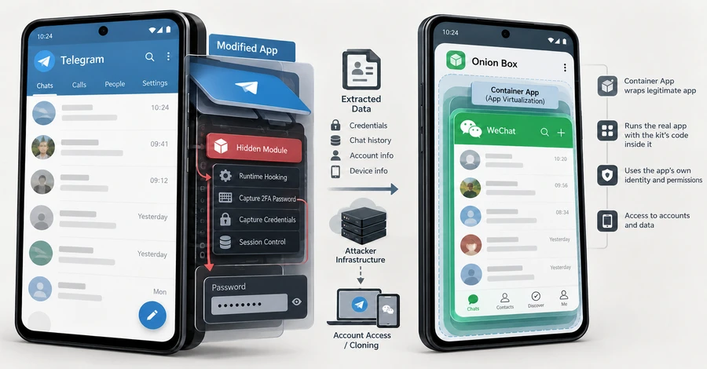
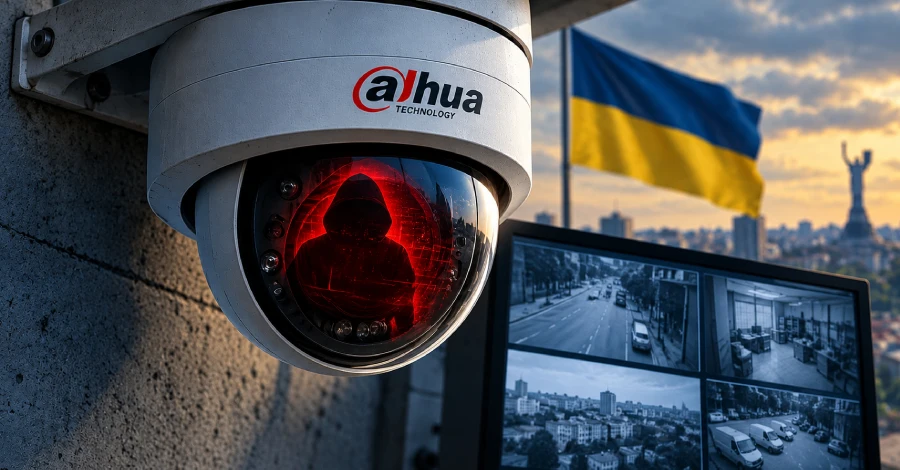

---
hide:
  - toc
---

Security Operations Briefing

# Incidents

A living, day-by-day catalogue of cybersecurity incidents, vulnerabilities, malware campaigns, and threat-actor activity — each entry a standalone briefing on what happened, what's affected, and what to do about it.

<!--INDEX_DATE-->Friday, October 30, 2026<!--/INDEX_DATE-->

-   {.index-card__img}

    **Signal Call-Termination Vulnerability - CVE-2026-113380**

    **Signal**{.cve-chip} **RingRTC**{.cve-chip} **CVE-2026-113380**{.cve-chip} **CVSS 9.3**{.cve-chip} **Call Privacy Risk**{.cve-chip}

    A critical RingRTC queue-saturation flaw could block hang-up handling, potentially leaving call media active after users believe a call ended.

    [Read more →](2026/Week43/Signal.md){.index-card__cta}

-   {.index-card__img}

    **uCreator Android Spyware (YingGai)**

    **uCreator**{.cve-chip} **Android Spyware**{.cve-chip} **Telegram 2FA Theft**{.cve-chip} **WeChat Cloning**{.cve-chip} **Virtualization Abuse**{.cve-chip}

    Researchers report a commercial spyware platform that abuses app virtualization and modified messaging clients to steal credentials, sessions, and messaging data.

    [Read more →](2026/Week43/uCreator.md){.index-card__cta}

-   {.index-card__img}

    **Unauthorized Access to Dahua Surveillance Cameras and Video Recorders via Easy4IP**

    **Dahua**{.cve-chip} **Easy4IP P2P**{.cve-chip} **CVE-2021-33044**{.cve-chip} **CVE-2021-33045**{.cve-chip} **Surveillance Access**{.cve-chip}

    CERT-UA reported unauthorized access activity affecting Dahua camera and recorder deployments through Easy4IP pathways, weak credentials, and auth-bypass exposure.

    [Read more →](2026/Week43/Dahua.md){.index-card__cta}

<footer class="index-footer" markdown>

published by EG-ETCS team on GitHub

<nav class="index-footer__nav" markdown>

[Organization](https://github.com/EG-ETCS){.index-footer__link}

[Incidents Repo](https://github.com/EG-ETCS/Incidents){.index-footer__link}

</nav>

</footer>

