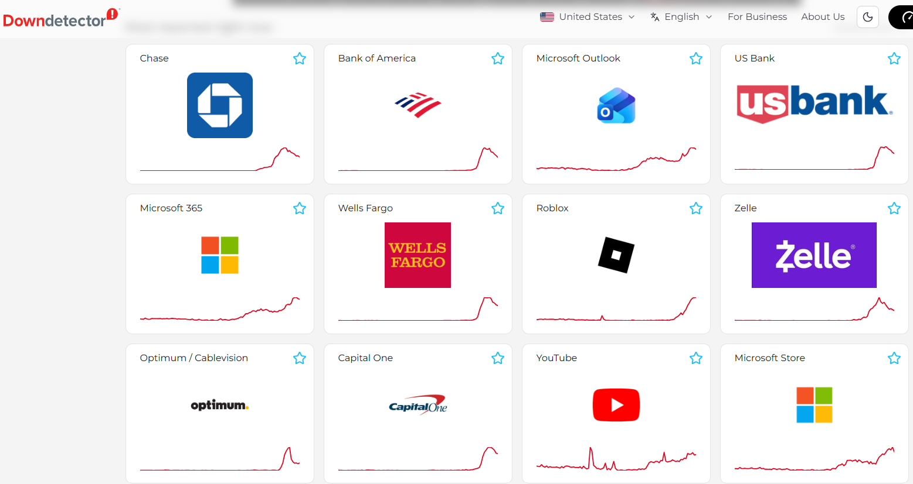
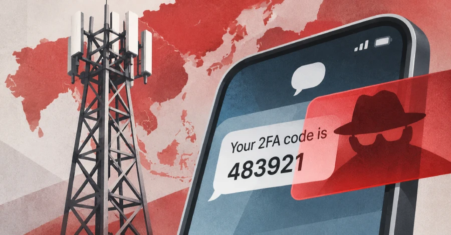

---
hide:
  - toc
---

Security Operations Briefing

# Incidents

A living, day-by-day catalogue of cybersecurity incidents, vulnerabilities, malware campaigns, and threat-actor activity — each entry a standalone briefing on what happened, what's affected, and what to do about it.

<!--INDEX_DATE-->Tuesday, November 24, 2026<!--/INDEX_DATE-->

-   {.index-card__img}

    **U.S. Banks Struggle With Outages Amid Wider Technology Disruptions**

    **Infrastructure Outage**{.cve-chip} **Banking Systems**{.cve-chip} **Service Disruption**{.cve-chip} **JPMorgan Chase**{.cve-chip}

    Multiple major U.S. banks experienced significant service disruptions affecting online banking, mobile applications, and financial transactions. JPMorgan Chase attributed the outage to a software bug in on-premises hardware systems, with no evidence of cyberattack.

    [Read more →](2026/Week46/Banks.md){.index-card__cta}

-   {.index-card__img}

    **Optimizely Supply Chain Attack – Malicious JavaScript Injection Targeting Major Websites**

    **Supply Chain Attack**{.cve-chip} **Malicious JavaScript**{.cve-chip} **Data Theft**{.cve-chip} **CDN Compromise**{.cve-chip}

    Attackers exploited a vulnerability in Optimizely's account registration process to inject malicious JavaScript into 188 files across 178 organizations, including CNN, BBC, Fox News, Zoom, and Salesforce. Malware targeted payment card theft, cryptocurrency wallet hijacking, and iOS device exploitation.

    [Read more →](2026/Week46/Malicious.md){.index-card__cta}

-   {.index-card__img}

    **SilentAir – Telecom Network Espionage Campaign**

    **Telecom Espionage**{.cve-chip} **SS7/Diameter Exploitation**{.cve-chip} **State-Sponsored**{.cve-chip} **Taiwan**{.cve-chip}

    SilentAir, a suspected state-level cyber-espionage actor, compromised telecommunications infrastructure across multiple Asian countries to intercept SMS messages, obtain subscriber information, and capture SMS-based 2FA codes from government officials and political figures in Taiwan.

    [Read more →](2026/Week46/SilentAir.md){.index-card__cta}

-   {.index-card__img}

    **Apple Bluetooth and AirPlay Pairing Vulnerabilities (Multiple CVEs)**

    **Bluetooth Vulnerabilities**{.cve-chip} **AirPlay Pairing Bypass**{.cve-chip} **CVE-2026-113964**{.cve-chip} **Apple**{.cve-chip}

    Apple released critical security updates addressing five vulnerabilities affecting Bluetooth and AirPlay pairing mechanisms. These flaws allow attackers to bypass pairing-code restrictions, establish unauthorized connections without user interaction, or trigger memory corruption on affected devices.

    [Read more →](2026/Week46/AirPlay.md){.index-card__cta}

<footer class="index-footer" markdown>

published by EG-ETCS team on GitHub

<nav class="index-footer__nav" markdown>

[Organization](https://github.com/EG-ETCS){.index-footer__link}

[Incidents Repo](https://github.com/EG-ETCS/Incidents){.index-footer__link}

</nav>

</footer>

